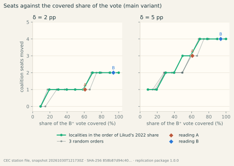
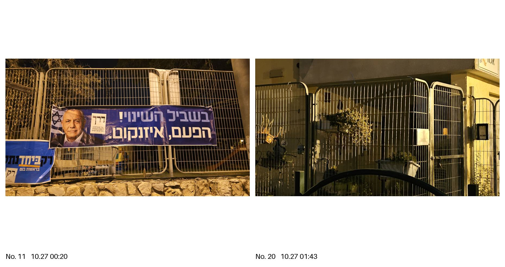

::: {lang="he"}
# תקציר {#takzir}

בלילה שלפני הבחירות לכנסת ה־26 (27 באוקטובר 2026) הוסרו שלטי הרשימות המתנגדות לממשלה מגדרות מקומות קלפי בעיר אחת בישראל, ועל פי עדות הראייה של עורך הטקסט נמצאו במקומם שלטי הליכוד. אנו שואלים שאלה מותנית: אילו הוחלה אותה החלפה בכל מקום שבו נוכחות הליכוד אינה שולית — המגזר היהודי הלא־חרדי, 80 % מן הקלפיות ו־77.2 % מן הקולות הכשרים שניתנו בהן — כמה מתוך 120 המנדטים הייתה עשויה להזיז? אפקט היפותטי δ מופחת מן הליכוד ביישובים המכוסים של תוצאות האמת של ועדת הבחירות המרכזית, מוחזר לרשימות גוש השינוי באופן יחסי, וחלוקת המנדטים בשיטת בדר–עופר מחושבת מחדש במדויק, עם אחוז החסימה של 3.25 % והסכמי העודפים. בתרחיש המרכזי, כאשר δ שווה לנקודת אחוז אחת, עובר מנדט אחד: הליכוד מ־27 ל־26, ישראל ביתנו מ־7 ל־8. על פני δ מ־0.2 עד 5 נקודות עוברים בין אפס ל־4 מנדטים, הראשון כאשר ⁦δ = 0.36⁩; ההסתברות למנדט אחד לפחות היא 96 % על פני טווח הערכים של δ בספרות המחקר ו־67 % בהנחת התפלגות ספקנית. המספרים מותנים בהנחת היסוד, שאותה התוצאות שפורסמו אינן יכולות לאשר או להפריך; הם מציינים את סדר הגודל שעליו שואל המבחן המשפטי «עשוי היה להשפיע על תוצאות הבחירות» (סעיף 86 לחוק הבחירות לכנסת \[נוסח משולב\]). כל הקוד, הנתונים הרשמיים והטבלאות הדרושים לשחזורם מפורסמים.
:::

**About this text.** The text, the code and the computations were drafted by an AI coding assistant (Claude Code, Anthropic) under the direction of Raveh Neeman, who set the question, the premise, the coverage readings and the δ grid, reviewed every number and every sentence and takes responsibility for the text as its editor; it carries no author’s ORCID. The editor is also the eyewitness of the documented case; the computation does not rest on his testimony (Statements). Every number is produced by the operations stated as formulas in Appendix E and implemented in the code it names, and checked as described in Appendix F.

**What this article says.** Under the premise that the replacement documented in Yokneam Illit was applied across the non-haredi Jewish sector with an effect of one percentage point, the seat allocation moves one seat — Likud 27→26, Yisrael Beiteinu 7→8. **What it does not say:** that the replacement happened anywhere but in that town; who removed or hung anything; that a seat was in fact moved; that «4 seats» or «98 %» are its result — the first is the top corner of the grid (the whole Jewish sector, δ = 5), the second is one of three distributions of δ, and under a sceptical one the first seat has a probability of 67 %; and that the documented town alone could have moved a seat — at δ = 5 it would move 760 votes, against the 14,552 the first seat needs.

# 1. Introduction

Between midnight and three in the morning of election day, 27 October 2026, the posters of the lists opposing the government were taken down from the fences of five polling sites in Yokneam Illit, a town of some twenty thousand voters in northern Israel, and, on the account of the eyewitness who is the editor of this text, Likud posters were hung in their place. He had hung the removed posters with his team that evening, photographed one fence before and after, and called the police at 02:18 (Appendix H). The removals themselves were not witnessed by the team or recorded, and the article makes no finding as to who removed the material or who hung Likud’s. Whether the same happened elsewhere that night is not known from public data, and this article does not claim that it did.

The article asks a conditional question. *If* the replacement of one bloc’s outdoor advertising by another’s was applied wherever Likud’s presence is not marginally low — operationally, the non-haredi Jewish sector, 80 % of the regular polling stations and 77.2 % of the valid vote cast at them (reading B, § 2.2) — how many of the 120 Knesset seats could it have moved? The premise is stated once, here, as a condition; everything that follows is arithmetic under it: the seat-allocation law applied exactly to the Committee’s final results, with a posited vote effect δ removed from the covered localities and returned to the lists whose posters were removed. Neither of the two inputs — where the replacement was applied and what it did to the exposed voters — is measured in public data. The coverage is therefore a reading fixed on the previous election’s results, and the effect a central scenario with its range, so that a reader can see what each value requires.

The answer is this. At the central scenario, δ = 1 percentage point of a covered locality’s valid votes, one seat moves: Likud 27→26 and Yisrael Beiteinu 7→8, the coalition bloc 53→52. The same seat moves at δ = 1 under every coverage reading of this article, from 37 % to 82 % of the vote. The first seat needs δ = 0.36 under reading B (14,552 votes) and the second δ = 1.43; at δ = 5, the largest effect the literature reports for a whole two-week campaign, 4 seats move. Integrating over three distributions of δ, the probability of at least one seat under reading B is 96 % over the literature’s range, 98 % under the premise’s own reading and 67 % under a sceptical one (§ 4.3).

Two reasons make the question worth answering exactly, now. Israeli law provides an election appeal whose test is not whether a defect changed the result but whether it «could have affected the results of the election» (§ 86 of the Knesset Elections Law \[Consolidated Version\], 5729–1969; *עשוי היה להשפיע על תוצאות הבחירות*). The appeal is to be filed within fourteen days of the publication of the results in the official gazette, which must follow the election within eight days under § 11 of the Basic Law (Basic Law: The Knesset, 1958) and § 84(a) of the Elections Law — no later than 18 November 2026. A seat-scale calculation is the quantity that test names, and courts elsewhere have applied the same logic: the German Federal Constitutional Court ordered a partial repeat of the 2021 Bundestag election in Berlin on the test of *Mandatsrelevanz* (BVerfG, 2 BvC 4/23, 2023), and the Austrian Constitutional Court annulled the 2016 presidential run-off on the possibility of influence (Neuwirth & Schachermayer, 2016). And the same number is the stake of protecting campaign material around polling places by law (§ 6). The rest of the article says where every number comes from (§§ 2–4) and what the numbers do not mean (§ 5).

# 2. What is posited

## 2.1 The documented case

The case file (Appendix H) records what one team of three people saw. Between 21:00 on 26 October and 01:30 on 27 October the team hung posters of three change-bloc lists on the fences of six of the town’s twelve polling sites. At the site on Ya’ar Odem Street 29 (יער אודם 29) the posters are photographed in place at 00:07–00:20 and the gate is photographed bare at 01:43–01:44. Between 02:00 and 03:00 the witness confirmed that the advertising of all lists not supporting the coalition had disappeared at five sites — four of the six where the team had hung posters and a fifth where it had not — and that Likud advertising hung on the freed places; this last rests on the statement alone. He reported the matter to the police by telephone at 02:18 and received a call back at 02:25 with, in his summary, no intention to act; he did not seek to file a complaint. The evidence is the verbatim statement of a named eyewitness with twenty-three time-stamped photographs and no independent source; the file grades it D on the project’s scale and records the attribution to Likud teams as the witness’s inference. The team’s own placement of posters on school fences on the eve of the election is subject to § 10 of the Elections (Modes of Propaganda) Law, 5719–1959 (Elections (Modes of Propaganda) Law, 1959) and to the municipal by-law, and this article does not argue its lawfulness. Removing, destroying or defacing a notice carrying the election propaganda of a list is an offence under § 126(2) of the Knesset Elections Law whoever placed the notice and wherever it hung (Knesset Elections Law, 1969). Two documented events of other kinds that month — the Lod municipality’s removal of the Joint List’s posters while Likud’s stayed up (Foldesh, 2026), and anonymous billboards styled as Ra’am’s own campaign (Spiegel et al., 2026) — are not part of the premise.

Yokneam alone could not have moved a seat: its 34 stations cast 15,200 valid votes in 2026, so the transfer of § 3.3 would move 152 votes there at δ = 1 and 760 at δ = 5, against the 14,552 votes the first seat needs under reading B. The town’s own 2022→2026 swing (Likud 33.1 → 30.1 %) is uninformative about the premise, for the reason given in § 5.

## 2.2 The premise and where it applies

The premise speaks of a replacement wherever Likud’s presence is not marginally low. Three readings of that phrase were fixed before the computation and operationalised on the 2022 results, the last election before the campaign, so that the covered set does not depend on the 2026 outcome:

- **Reading B**, the main reading — the non-haredi Jewish sector: localities classified Jewish by the Central Bureau of Statistics (CBS) and not haredi by voting history, plus the stations of the nine mixed cities (Jerusalem, Tel Aviv-Yafo, Haifa, Lod, Ramla, Acre, Nof HaGalil, Ma’alot-Tarshiha and Neve Shalom) whose combined share of the two Arab lists in 2026 is below 20 %: 1,048 localities, 9,593 of the 12,018 regular stations (79.8 %), 77.2 % of the valid votes cast at regular stations (71.1 % of all valid votes). This is the sector in which Likud campaigns and hangs posters, and so the bound of where a national campaign organisation could have applied the practice. The station rule inside the mixed cities is the one place where a 2026 quantity enters a definition: stations are renumbered between elections, so their 2022 shares cannot be matched; the rule sorts stations by sector, not by swing, and they carry 15.5 % of the regular vote.
- **Reading A**, the narrow alternative — localities where Likud was the first list in 2022 or trailed the first list by at most five points: 361 localities, 52.1 % of the stations, 50.0 % of the regular valid vote. Yokneam Illit (Likud 33.1 % in 2022) is one of them.
- **Reading B⁺**, the widest — reading B plus the 19 haredi localities: 82.2 %.

Reading A is cross-checked against an independent indicator, the prime minister’s own campaign itinerary (Appendix G, with the press sources): the 17 localities of his ordinary in-person campaign stops in 2026 had Likud shares of 28.5–50.9 % in 2022, median 35.7 %, and Yokneam sits inside that range. The rule «Likud share 2022 ≥ 28.5 %» (reading I), with the threshold set by the lowest of those stops, covers 36.5 % of the vote and is reported in Appendix A with the A rule at other gaps. Table 1 gives the composition of each set.

**Table 1. Coverage sets (2026 regular stations; sector labels from the CBS file and the 2021–2022 results): localities, stations, share of the regular stations and of the regular valid vote.**

| Set | Rule | Localities | Stations | Stations, % | Regular vote, % |
|-------------------|-----------------------|-------:|-------:|-------:|-------:|
| B — non-haredi Jewish sector | CBS Jewish localities that are not haredi by voting history, plus the stations of the mixed cities whose Arab-list share in 2026 is below 20 % | 1,048 | 9,593 | 79.8 | 77.2 |
| A — Likud first or within 5 pp (2022) | Likud first in the locality in 2022 or within 5 percentage points of the first list | 361 | 6,266 | 52.1 | 50.0 |
| B⁺ — Jewish sector including haredi localities | B plus the haredi localities | 1,067 | 10,146 | 84.4 | 82.2 |

# 3. Method

## 3.1 Data

The 2026 results are the Central Elections Committee’s final station-level results (*תוצאות האמת*, «the true results», published on 30 October 2026 (Arutz 7, 2026)), as downloaded on 30 October 2026 at 12:17 UTC (Central Elections Committee for the 26th Knesset, 2026) (file name and SHA-256 checksum in Appendix D). The file holds 12,018 regular polling stations in 1,224 localities with 5,241,327 valid votes, plus 449,358 valid votes in externally cast («double») envelopes — soldiers, diplomats, patients, prisoners and other absentee voters — which belong to no locality. The national totals include the external envelopes; the coverage sets and the counterfactual act on regular stations only. The 2022 results are the final station-level file of the 25th Knesset (Central Elections Committee for the 25th Knesset, 2022). Localities are classified by the CBS localities file (Central Bureau of Statistics, 2025) into Jewish, Arab, Bedouin and mixed; haredi localities are those where the two haredi lists took at least half of the valid votes in 2021; Druze localities, coded with the Arab ones by the CBS, come from a list in the package. Every output carries the data version — the files’ time stamps and SHA-256 checksums (Appendix D).

## 3.2 Seat allocation

Israel elects its 120-member Knesset in a single nationwide district by closed lists. Lists with at least 3.25 % of the valid votes share the seats by the Bader–Ofer method (§§ 81–82 of the Knesset Elections Law): highest averages, with two lists that signed a surplus-vote agreement (*הסכם עודפים*) treated as one unit, their joint seats then divided by the same rule — the Jefferson–D’Hondt rule applied first to the pairs and then within each pair (Balinski & Young, 2001; Pukelsheim, 2017). Our implementation (in the package; Appendix E names an independent single-file reimplementation) returns the official allocation of the 25th Knesset list for list on the final 2022 file — a test in the package (passed). The five agreements of 2026 — Beyachad (Bennett)–Yisrael Beiteinu, Yashar! (Eisenkot)–The Democrats (Golan), Joint List–Ra’am, Likud–Religious Zionism–Zehut, Shas–UTJ — are taken from two concordant press reports (Knesset Channel, 2026; Oren, 2026); the Committee’s own notice could not be reached and the pairs are marked unverified in the package. In the count used here 5,690,685 valid votes were cast, 184,947 were needed to pass the threshold, 11 lists passed it and 307,899 votes (5.4 %) went to lists that did not. One seat therefore corresponds to 47,422 valid votes (0.83 % of the valid vote). The allocation is a step function: the 120th seat went to the pair Joint List–Ra’am with a quotient of 44,074, and the best losing quotient, 43,722 for Shas–UTJ, fell short of it by 4,922 votes (Appendix E.2). A shift of a few thousand votes in the right place moves a seat; a shift of tens of thousands in the wrong place moves none — which is why a seat estimate has to be computed exactly rather than divided out of a national swing. Table 2 gives the factual allocation and, beside it, the allocation at the central scenario.

**Table 2. Allocation of the Committee’s results of 30 October 2026, and the allocation under the counterfactual at δ = 1, reading B (lists above the threshold and the largest below it).**

| List (ballot letters) | Bloc | Votes | Share, % | Seats | Seats at δ = 1, B |
|------------------------|-----------|-----------:|----------:|--------:|--------:|
| Likud (מחל) | coalition | 1,167,458 | 20.52 | 27 | **26** |
| Yashar! (Eisenkot) (דרך) | change | 913,502 | 16.05 | 21 | 21 |
| Beyachad (Bennett) (רק) | change | 531,476 | 9.34 | 12 | 12 |
| Joint List (ודם) | Arab | 500,147 | 8.79 | 11 | 11 |
| The Democrats (Golan) (אמת) | change | 366,352 | 6.44 | 8 | 8 |
| Yisrael Beiteinu (ל) | change | 337,413 | 5.93 | 7 | **8** |
| Ra’am (עם) | Arab | 337,253 | 5.93 | 8 | 8 |
| Otzma Yehudit (ב) | coalition | 326,624 | 5.74 | 7 | 7 |
| UTJ (ג) | coalition | 312,604 | 5.49 | 7 | 7 |
| Shas (שס) | coalition | 299,506 | 5.26 | 6 | 6 |
| Religious Zionism–Zehut (ט) | coalition | 290,451 | 5.10 | 6 | 6 |
| Reservists–Economic (די) | other | 154,995 | 2.72 | 0 | 0 |
| *Blocs: coalition / change / Arab* |  |  |  | 53 / 48 / 19 | 52 / 49 / 19 |

The *coalition bloc* is the five lists that backed the incumbent prime minister before the election (Likud, Religious Zionism–Zehut, Otzma Yehudit, Shas, UTJ), the *change bloc* the four that ruled that out (Yashar! (Eisenkot), The Democrats (Golan), Yisrael Beiteinu, Beyachad (Bennett)) and the *Arab bloc* the two Arab lists; «coalition seats» are the seats of the first bloc. The labels only report results — the allocation itself knows nothing of blocs — and Appendix C shows that an alternative frame changes the labels, not the arithmetic.

## 3.3 The counterfactual transfer

Let δ be the effect of the replacement on the exposed voters: the average treatment effect on vote share at the level of a covered unit, in percentage points of the unit’s valid votes moved from Likud to the change-bloc lists — the quantity the field experiments of § 3.4 report, not a persuasion rate; as a net transfer it changes the Likud–change margin by 2δ. The factual results are, under the premise, the results *with* the replacement; the counterfactual removes it. For every covered unit — a locality, or, in a mixed city, its covered stations together — Likud’s votes are reduced by round(δ/100 × valid votes of the unit), capped at the Likud votes present, and the removed votes are returned to the four change-bloc lists in proportion to their actual votes in the unit, integer-exact by largest remainders. This rule — locality units, pro-rata return — is the *main variant*. Everything else is untouched, so the total of valid votes is conserved; the national totals are re-allocated with the same threshold and agreements. The cap binds only where Likud’s local share is below δ and amounts to under 0.8 % of the moved votes at δ = 5 under reading B. δ need not be uniform: because the rule removes a share of each unit’s valid votes, a varying δ moves the same total as a uniform δ with the same vote-weighted mean; what changes is who receives the votes and where the cap binds, which the variants test.

Five variants probe the rule (§ 4.4). *Station units*: the transfer station by station rather than locality by locality. *Single recipient* (three variants): all removed votes return to one list — each of the three lists whose posters the witness hung (Yashar!, The Democrats, Beyachad) in turn — the extreme of an uneven return. *Likud mobilisation*: the removed votes vanish instead of moving, as if the replacement had brought Likud voters to the polls who would otherwise have stayed home; a demobilisation of change-bloc voters — votes not cast rather than moved — is a third direction, not modelled as a variant and entered in § 3.4 at half weight. The threshold channel — a list below the threshold carried over it by the advertising it lost — is deliberately not modelled: the recipients are lists already above the threshold, the set of qualifying lists is held at the factual one, and the code records any deviation (there is none in any cell). The largest list below the threshold, Reservists–Economic, stood at 2.72 %; whether its material was removed anywhere is unknown.

## 3.4 The effect δ

δ is not estimated in this article: we found no study that measures the effect on votes of removing an opponent’s outdoor advertising, let alone of replacing it with one’s own. What is measured is nearby. The only randomised field experiments with signs we found, four in 376 US precincts, give a pooled effect of +1.7 percentage points (standard error 0.7) for the advertised candidate and no effect on turnout (Green et al., 2016). The closest study to the Israeli medium is a working paper on Barcelona, where the municipality assigns lamp-post banner and poster slots to parties by lottery: +0.61 to +0.96 points of vote share per standard deviation of a party’s poster density around a census tract, negative effects of a distant party’s posters. It also reports +5 points for a party in tracts whose residents saw posters of that party only — single-party exposure, the closest analogue of a street on which only one side is visible (Esteban-Casanelles, 2021). Canadian household signs are of the same order, +1.5 to +3.4 points with diminishing returns (Maurice et al., 2023). For scale, the persuasive effect of campaign contact and advertising in general elections is close to zero, with a 95 % interval of roughly −0.5 to +1.7 points across 49 field experiments (Kalla & Broockman, 2018). Television advertising shifts vote intention by about 0.7 points per exposure, not distinguishable from zero (Coppock et al., 2020), and shares by 0.2–0.5 points per standard deviation of imbalance (Sides et al., 2022; Spenkuch & Toniatti, 2018). Persuasive effects decay within one or two weeks (Gerber et al., 2011; Hill et al., 2013), so that exposure on the way to the polling station weighs more than exposure a week earlier. Posters of large parties act as signals of campaign strength (Dumitrescu, 2012); a one-sided campaign in a repeat vote multiplied the lone campaigner’s share several times (Jäger, 2020).

The grid of Table 3 ties each scenario to one of these anchors. The premise is more specific than the literature: a replacement carried out in one night and visible through election day, and — in the editor’s reading of it — a sudden and total imbalance of posters that signals dominance — the governing party can do this, and the other side can do nothing about it. Table 3a assembles δ for that scenario from measured parts; the parts are the editor’s judgement, stated so that a reader can replace them one by one. The first is the exclusivity effect, +5 points for two weeks of single-party exposure, which is the standing level of a decaying stock of exposures; one night and one day deliver 14–41 % of that level at half-lives of 7 to 2 days, 0.7–2 points. The second is the dominance signal: a bandwagon among late deciders — information about who is ahead moves some of them towards the leader by a few points (Barnfield, 2020; Morton et al., 2015; Rothschild & Malhotra, 2014) — and a demobilisation of the other side, which the intimidation literature documents for threats and violence (Bratton, 2008; Collier & Vicente, 2014) and which a poster imbalance can at most echo. A vote not cast changes the margin by half as much as a vote moved, so the demobilisation part enters the transfer sum at half weight. The third is a deduction for backlash, the outrage of the targeted side and underdog reactions (Claassen & Ensley, 2016).

**Table 3. The δ grid and its anchors.**

| δ, pp | Anchor |
|-------:|----------------------------------------------------------------|
| 0.4 | lower bound: two effects of the size of a television-advertising effect (0.2 pp each, § 3.4) for the remaining day |
| 1 | presence effect of street posters per SD of density, Barcelona working paper (0.61–0.96), rounded up |
| 1.2 | replacement as loss plus gain of presence, one SD each (Barcelona working paper) |
| 2 | single-party exposure weighted to the last day (centre of the range reviewed in § 3.4) |
| 3.4 | twice the pooled lawn-sign effect of the randomised field experiments (1.7 pp), a full campaign on both sides |
| 5 | single-party exposure for a whole two-week campaign, Barcelona working paper (upper bound) |

**Table 3a. δ under the premise, assembled from measured parts (percentage points of a covered locality’s valid votes, net transfer from the change bloc to Likud).**

| Part | Measured analogue | Range, pp | Centre |
|------------------------|--------------------------------|--------:|------:|
| Exclusivity: one side’s posters alone, one night and one day | +5 pp after two weeks of single-party exposure (working paper); 14–41 % of a decaying stock delivered in a day and a half at half-lives of 7 to 2 days | 0.7–2.0 | 1.2 |
| Bandwagon among late deciders (dominance signal) | a few points among those who receive a signal of who is ahead; the late-deciding minority | 0.1–0.6 | 0.3 |
| Demobilisation of the other side (dominance signal) | threats and violence depress the targeted side’s turnout; a poster imbalance is a weak cue; 0–0.5 points of turnout, at half weight as transfer | 0–0.25 | 0.1 |
| Backlash | outrage of the targeted side; underdog reactions | −0.3 to 0 | −0.1 |
| Sum |  | 0.5–2.9 | ≈ 1.5 |

Three distributions of δ are carried through the results (Table 3b): the literature’s range, 0.4–5 points; the premise’s own reading, whose 5th percentile is the low of Table 3a and whose upper tail is widened to admit the reading in which a display seen on the way to the polling station is not discounted for decay at all. The third is a sceptical distribution (labelled «minimal persuasion effects» in the tables) that takes the 95 % interval of persuasion effects in general elections as the range of δ, cut below at 0.15 because the question concerns a positive effect. Each is a log-normal fixed by its 5th and 95th percentiles; none is a posterior — each propagates the uncertainty about δ only, treats the coverage as fixed by the premise and attaches no sampling error to the vote counts, which are population data.

**Table 3b. The distributions of δ (log-normal, fixed by the 5th and 95th percentiles).**

| Distribution | 5th pct | Median | 95th pct | What it formalises |
|------------------|-------:|-------:|-------:|------------------------------|
| literature range | 0.4 | 1.41 | 5 | the ends of the δ grid: two television-sized effects for the remaining hours to single-party exposure for a whole campaign (Table 3) |
| the premise’s own reading | 0.5 | 1.50 | 4.5 | the components of Table 3a: exclusivity discounted to one night and one day, a dominance-signal premium, a deduction for backlash |
| minimal persuasion effects | 0.15 | 0.50 | 1.7 | the 95 % interval of persuasion in general elections (49 field experiments) taken as the range of δ |

The central scenario of this article is δ = 1. The parts of Table 3a centre near 1.5 and the medians of the first two distributions are 1.4 and 1.5; δ = 1 is a round value in the lower half of the premise’s own range, the Barcelona presence effect rounded up, and the headline that follows from it is the conservative one. Under reading B the answer «one seat» holds for every δ from 0.36 to 1.43 points. A reader who holds that the replacement moved no seat should read the article as a statement of what that claim requires: δ below 0.36 points under reading B and below 0.53 under A in the main variant.

## 3.5 Reproducibility

Everything in this article is produced by one command of the replication package from the archived official files: the factual allocation, the coverage sets, the grid, the step curves, the integration over δ, every table, every figure and the text itself, whose numbers are filled from a machine-readable results file that carries the data version (Appendix D). Appendix E restates every operation as a formula and names a single-file reference implementation (link, line count, SHA-256), written separately from the package, that recomputes every number of this text from the published tables alone; Appendix F lists the checks. Every file the text names is linked to its copy in the public repository.

# 4. Results

## 4.1 The central scenario

At δ = 1 under reading B the counterfactual moves 40,438 votes (0.71 % of the national valid vote) from Likud to the four change-bloc lists, and one seat moves: Likud 27→26, Yisrael Beiteinu 7→8 (Table 2, last column). The mechanism is the step function of § 3.2: the Likud–Religious Zionism pair’s last quotient falls below the Beyachad–Yisrael Beiteinu pair’s next one, and inside that pair Yisrael Beiteinu’s next quotient is the higher. The result does not depend on the reading: at δ = 1 the same seat moves under every coverage set of this article, from the itinerary rule (37 % of the vote) to the whole Jewish sector (82 %; Table 4 and Appendix A), and under the station-unit variant and the return of all votes to Beyachad. It does not hold in two single-recipient variants under reading A (0 seats in each, § 4.4) nor in the Likud-mobilisation variant (0 seats under both readings).

## 4.2 Breakpoints and the grid

Under the main variant the first coalition seat moves to the change bloc at δ = 0.36 under reading B and δ = 0.53 under reading A; the second at 1.43 and 2.29; the third at 2.83 and 4.01; the fourth at 3.52 and 5.53 (Figure 2). At δ = 0.2 no seat moves under any reading. The steps are unequal because the allocation is a step function of eleven lists’ quotients: under reading B the second seat needs 1.07 points of δ more than the first, the third 1.40 more than the second. Table 4 gives the grid; the seats leave Likud in every cell and, with the exceptions noted next, go to the change-bloc lists, and the Arab bloc is unaffected in the main variant. In two cells Likud loses more seats than the coalition total — B at δ = 5 (Likud −5, coalition −4; the difference goes to Shas); B⁺ at δ = 5 (Likud −5, coalition −4; the difference goes to Shas) — because a seat the Likud–Religious Zionism pair loses goes to whichever pair holds the next-best quotient, which can be a coalition partner. The full grid with the votes moved and the per-list allocations is in Appendix B.

**Table 4. Coalition seats moved by the counterfactual, main variant; the central scenario in bold.**

| Set                   | δ = 0.4 | δ = 1 | δ = 1.2 | δ = 2 | δ = 3.4 | δ = 5 |
|-----------------------|--------:|------:|--------:|------:|--------:|------:|
| B (77 % of the vote)  |       1 | **1** |       1 |     2 |       3 |     4 |
| A (50 % of the vote)  |       0 |     1 |       1 |     1 |       2 |     3 |
| B⁺ (82 % of the vote) |       1 |     1 |       1 |     2 |       4 |     4 |

## 4.3 Integrating over δ

**Table 5. Integrating over δ, main variant: 200,000 draws under each distribution of Table 3b.**

| Distribution of δ | Set | P(≥ 1 seat), % | P(≥ 2), % | P(≥ 3), % | Mean seats | 90 % interval |
|------------------------|------|---------:|-------:|-------:|-------:|---------:|
| literature range | B | 96.2 | 49.2 | 18.1 | 1.86 | \[1, 4\] |
|  | A | 89.9 | 26.4 | 8.6 | 1.31 | \[0, 3\] |
| the premise’s own reading | B | 98.4 | 52.7 | 16.9 | 1.85 | \[1, 4\] |
|  | A | 94.0 | 26.2 | 7.0 | 1.31 | \[0, 3\] |
| minimal persuasion effects | B | 67.5 | 7.8 | 0.9 | 0.77 | \[0, 2\] |
|  | A | 47.2 | 2.0 | 0.2 | 0.50 | \[0, 1\] |

Under the literature’s range and reading B, one seat (47 % of the draws) and two seats (31 %) share most of the mass and the outcome of no seat has 4 %; under reading A the modal outcome is one seat (64 %), with 10 % for none. The premise’s own reading gives nearly the same figures. Under the sceptical distribution the probability of at least one seat falls to 67 % under B and 47 % under A: the number most sensitive to the choice of distribution is the probability of the first seat under reading A, whose breakpoint, δ = 0.53, sits where a sceptic’s δ sits; under reading B the first seat needs δ = 0.36, below every distribution’s median. Adding the haredi localities (B⁺) changes little, because Likud’s share there is small and the cap binds (Appendix A). The reference implementation integrates the same step function exactly and agrees with the draws within half a point (Appendix F).

## 4.4 Sensitivity to the transfer rule

**Table 6. Coalition seats moved by variant (reading B / reading A).**

| δ, pp | pro rata, locality units (main) | pro rata, station units | all to Yashar! | all to The Democrats | all to Beyachad | Likud mobilisation |
|------:|----------:|----------:|----------:|----------:|----------:|----------:|
| 0.4 | 1 / 0 | 1 / 0 | 0 / 0 | 0 / 0 | 1 / 1 | 0 / 0 |
| 1 | 1 / 1 | 1 / 1 | 1 / 0 | 1 / 0 | 1 / 1 | 0 / 0 |
| 1.2 | 1 / 1 | 1 / 1 | 1 / 0 | 1 / 0 | 1 / 1 | 0 / 0 |
| 2 | 2 / 1 | 2 / 1 | 2 / 1 | 2 / 1 | 2 / 1 | 1 / 0 |
| 3.4 | 3 / 2 | 3 / 2 | 3 / 2 | 3 / 2 | 3 / 2 | 2 / 1 |
| 5 | 4 / 3 | 4 / 3 | 4 / 3 | 4 / 3 | 5 / 3 | 2 / 1 |

Station units and locality units give the same seat counts in every cell: the mix of recipients within a town does not matter at the scale of a seat. Returning all the votes to a single list can give a seat where the pro-rata return gives none and none where it gives one, because a seat moves only when a recipient’s next quotient overtakes the losing one; the single-recipient variants bracket the main variant rather than shifting it. The Likud-mobilisation variant moves fewer seats for the same δ: Likud’s loss is the same, but the freed seats go to whichever pair has the next-best quotient, including coalition partners, so the coalition total falls by 2 under B and 1 under A at δ = 5. The main variant is therefore not the most favourable variant in every cell.

## 4.5 Seats against the covered share

Readings A and B are two points of a range the premise leaves open. Figure 5 applies the main variant to the top x % of the B⁺ vote, taking the localities in the order of Likud’s 2022 share and, for comparison, in 3 random orders, at δ = 2 and δ = 5. At every covered share the ordered and the random coverages differ by at most one seat: from the second seat on, what the coverage decides is the volume of covered votes, not the choice of localities, and a reader who prefers another coverage can read the seats off the share of the vote it covers (the rows are the package’s `coverage_scaling` table).

# 5. What the numbers do not mean

**The premise is a condition, not a finding.** The documented replacement covers one town with 0.3 % of the regular vote; everything beyond it is conditional. The readings of § 2.2 were fixed in advance and cross-checked against the campaign itinerary, but another reader may prefer another set, which is why Appendix A reports other rules and the code accepts any set of localities. The standard a hostile reader will apply is the one formulated for the 2020 US claims — a purported anomaly is either not a fact or not anomalous (Eggers et al., 2021). The lesson of Bolivia 2019, where a statistical claim about an election was reversed on the same public data by another choice of estimator and the dispute ran for years (Escobari & Hoover, 2024; Idrobo et al., 2022), is why the method, the readings, the grid and the variants are published together from the first day. No pattern in the returns is claimed here.

**The aggregate swing neither confirms nor refutes the premise.** A natural check is whether the 2022→2026 swing of the covered localities differs from that of the uncovered ones. It cannot settle the question, for an identification reason: under the premise the decision to clear a locality depends on its political composition, so the contrast between cleared and uncleared localities coincides with the gradient of the coalition’s share, along which the swing varies without any clearing — regression to the mean, different mobilisation in strongholds and in mixed cities, the common drift of strongholds. A placebo comparison on the pair 2021→2022, where no replacement is posited, shows steps of the swing along that gradient of the same sign and size. If the clearing happened everywhere that mattered, its effect sits in Likud’s national swing, and the only uncleared comparison groups — Arab, haredi and left-leaning localities — differ from the cleared ones in everything else; the within-town contrast is closed too, because stations are renumbered between elections. Only a record of which fences were cleared and replaced — a dose — or an experiment can adjudicate the premise. The discipline followed here is that of the Moscow observer experiment: an effect, an explicit statement of where it applies, and a reservation on generalisation (Enikolopov et al., 2013).

**δ comes from other contexts.** The anchors are US lawn signs and Barcelona lamp-post posters, measured over weeks in contests with other ballot structures; the replacement itself has, to our knowledge, not been measured; in Yokneam it acted from the clearing through the hours in which voters passed the fences, against a background of television and online campaigning. The distributions formalise the range of the literature and the editor’s reading of the premise, and nothing more.

**The data are the Committee’s final results, not yet the gazetted ones.** The results of 30 October 2026 are the ones the Committee published as final (Arutz 7, 2026); the published file changed after the download used here, and the article re-runs in one command on any later file. The margin of the last seat was 4,922 votes, so the factual allocation may still change in the gazetted results, and with it every cell of the grid. The surplus-vote agreements are taken from two concordant press reports. The threshold channel is not modelled; the Jewish part of the mixed cities is defined by a station-level rule; the transfer is deterministic and integer-exact.

# 6. Implications and prevention

**The appeal.** For the test of § 86, the article supplies the magnitude under an explicit premise: the defect is the removal and replacement of a list’s propaganda at polling sites, an offence under § 126(2), documented at one site before and after; the magnitude is one seat at the central scenario and the first seat at δ = 0.36 under reading B. What the premise leaves open is the coverage, and a faction or list with a record of the localities affected can re-run the estimate on that set in one command (Appendix D). The standing to appeal lies with the members of the Central and district committees, the factions and members of the elected Knesset, the lists that took part and their candidates, and the Attorney General (§ 86(a)), within fourteen days of the gazette; the article claims nothing about the admissibility of any appeal.

**Prevention.** The law already names the act: § 126(2) and (3) of the Knesset Elections Law make removing, destroying or defacing a list’s notice, and destroying or hiding its campaign material, offences whoever placed them; what the law lacks is a regime for the night before the vote. Section 129 silences meetings, processions, loudspeakers and broadcasts from 19:00 on the eve and says nothing of printed material; the outer fence of a polling building counts as part of the polling place from election day (§ 126(5)) while campaigns use it on the eve by general practice. Enforcement rests with the police, whose record of the one documented case is a telephone report at 02:18 without an event number, no complaint having been sought (Appendix H). Four measures follow, cheapest first; none presumes who did what in Yokneam, and none is a claim that the 2026 result was changed. (i) A freeze on hanging and removing printed material at polling buildings from 19:00 on the eve, aligned with § 129, with a logged hotline whose log is published after the election; Italy forbids new posting and rallies on the eve and the days of the vote and penalises the removal of posters (Legge 212/1956, 1956). (ii) Official panels at the entrance with equal, numbered slots drawn by lot by the district committee, the rest of the fence free but recorded — the Italian *spazi* (Legge 212/1956, 1956); Germany forbids any influencing of voters in, at and immediately before the polling building during the vote (BWahlG § 32, 1993). (iii) A record: a photographic census of every polling building’s outer fence after 19:00 on the eve and before 07:00, keyed to the Committee’s polling-site identifier (ריכוז) and published with the gazetted results; existing cameras on the fence and the panels only, never on voters or the entrance, with retention and access written into the statute. (iv) A measurement mandate: the census describes; the effect of one-sided exposure is estimable only by a pre-registered design with symmetric arms agreed between the lists, the subject of a separate measurement design and not computed here. Witnesses can contribute now what Appendix H has and what it lacks: time-stamped photographs handed in as original files and hashed on receipt, a complaint with an event number, and a request for footage inside the retention period.

# Data and code availability

The replication package (Neeman, 2026) holds the code (the seat module with the code it imports and the input tables of lists, blocs and surplus agreements), the archived official files this build reads — the 2026 results, the 2022 file, the 2021 file from which the haredi labels are derived — with their checksums, the CBS localities file, the machine-readable results file, the CSV tables, the figures, this text’s template and bibliography, the public summary of the case file with the twenty-three photographs published in full (Appendix H; [`case-01-yokneam-public.md`](https://github.com/ravehn/seats-at-stake-israel-2026/blob/v1.0.0/docs/article/case-01-yokneam-public.md), [`case-01/`](https://github.com/ravehn/seats-at-stake-israel-2026/tree/v1.0.0/docs/article/case-01)). It also holds the reference implementation of Appendix E ([`replication/reference.py`](https://github.com/ravehn/seats-at-stake-israel-2026/blob/v1.0.0/docs/article/replication/reference.py)) with the tables it reads, and the command that regenerates all of them (Appendix D). Every file named in this text links to its copy in the public repository (https://github.com/ravehn/seats-at-stake-israel-2026, ref `v1.0.0`). The investigator’s protocol and the verbatim witness statement are retained by the editor and are not released. The package is prepared for deposit with a persistent identifier, to be added to this text when assigned.

# Statements

**Editor.** Raveh Neeman (independent researcher) is the editor of this article: he set the question, the premise, the coverage readings and the δ grid, reviewed every number and every sentence, and takes responsibility for the text as its editor; the text and the code were drafted by the AI tool named below under his direction. He is also the first-hand witness of the documented case in Yokneam Illit and hung the posters whose removal it records; he has been active for the opposition in that town’s campaigns since 2019, was a member of the Yesh Atid party centre until the summer of 2026 and is not a party member now. Because the computation takes the premise as a condition, a reader who sets the witness statement aside still has §§ 3–4 intact; the statement is the reason the question is asked, not evidence for its answer.

**AI.** Claude Code (Anthropic) drafted this text, wrote and tested the code and ran the analysis and the literature search, under the editor’s direction and subject to his review of every part. The transcripts of the sessions are retained by the editor; no number in the text comes from them — every number is produced by the code of Appendix E from the published files. References with a DOI were resolved and checked against Crossref ([`tools/verify_bib.py`](https://github.com/ravehn/seats-at-stake-israel-2026/blob/v1.0.0/tools/verify_bib.py)); every reference without a DOI was opened and checked against its source on 1 November 2026. The editor reviewed and takes responsibility for all of it.

**Independence.** This work has no client, no sponsor and no funding. Nobody outside the editor commissioned or paid for any part of it, and no other person saw the text before it was sent for review. The editor’s contact with the lists whose posters he hung was limited to reporting the removal to their local representatives on the morning of 27 October; none of them has seen this text.

# Glossary

| English | Hebrew | Note |
|----------------------|----------------------|-----------------------------|
| Bader–Ofer method | שיטת בדר–עופר | highest-averages allocation with surplus-vote agreements, §§ 81–82 |
| ballot letters | אותיות הרשימה | the one to three Hebrew letters that identify a list on the ballot (Table 2) |
| «the true results» | תוצאות האמת | the Committee’s name for its final results |
| polling station | קלפי | the unit of the Committee’s results file; *regular* (קלפי רגילה) when in a locality |
| polling site, building | מקום קלפי; ריכוז (the field of the Committee’s file) | a building, usually a school, holding several stations |
| locality | יישוב | the Committee’s and the CBS’s unit, by the CBS locality code |
| external («double») envelopes | מעטפות חיצוניות / כפולות | absentee ballots counted centrally, no locality |
| surplus-vote agreement | הסכם עודפים | two lists pooled for the allocation of remaining seats |
| electoral threshold | אחוז החסימה | 3.25 % of the valid votes |
| haredi | חרדי | ultra-Orthodox; a locality is haredi here if UTJ and Shas took at least half of its valid votes in 2021 |
| coalition bloc, change bloc | גוש הקואליציה, גוש השינוי | the lists that backed the incumbent prime minister; the lists that ruled that out (§ 3.2) |
| readings A, B, B⁺ | — | the coverage sets of § 2.2 |
| δ | — | the posited effect of the replacement, in percentage points of a unit’s valid votes moved from Likud |
| election appeal; «could have affected the results» | ערעור בחירות; עשוי היה להשפיע על תוצאות הבחירות | § 86 of the Knesset Elections Law; fourteen days from the gazette (רשומות) |
| outdoor advertising, posters, banners; replacement | שלטי חוצות, שלטים, כרזות; החלפה | the medium of the premise; removal of one side’s material and placement of the other’s |

# References

:::::::::::::::::::::::::::::::::::::::::: {#refs .references .csl-bib-body .hanging-indent entry-spacing="0" line-spacing="2"}
::: {#ref-inn2026final .csl-entry}
Arutz 7. (2026, October 30). *The final true results are published: This is the allocation of seats and the new bloc map ([פורסמו תוצאות האמת הסופיות: זוהי חלוקת המנדטים ומפת הגושים החדשה]{lang="he"}) (Hebrew)*. Arutz 7 (Israel National News). <https://www.inn.co.il/news/709660>
:::

::: {#ref-balinski2001fair .csl-entry}
Balinski, M. L., & Young, H. P. (2001). *Fair representation: Meeting the ideal of one man, one vote* (2nd ed.). Brookings Institution Press.
:::

::: {#ref-barnfield2020bandwagon .csl-entry}
Barnfield, M. (2020). Think twice before jumping on the bandwagon: Clarifying concepts in research on the bandwagon effect. *Political Studies Review*, *18*(4), 553–574. <https://doi.org/10.1177/1478929919870691>
:::

::: {#ref-knesset1958basic .csl-entry}
Basic Law: The Knesset, 5718–1958 ([חוק-יסוד: הכנסת, התשי"ח–1958]{lang="he"}) (1958). <https://he.wikisource.org/wiki/חוק-יסוד:_הכנסת>
:::

::: {#ref-bratton2008votebuying .csl-entry}
Bratton, M. (2008). Vote buying and violence in Nigerian election campaigns. *Electoral Studies*, *27*(4), 621–632. <https://doi.org/10.1016/j.electstud.2008.04.013>
:::

::: {#ref-bwahlg_s32 .csl-entry}
Bundeswahlgesetz (Federal Elections Act), § 32: Unzulässige Wahlpropaganda Und Unterschriftensammlung, Unzulässige Veröffentlichung von Wählerbefragungen (1993). <https://www.gesetze-im-internet.de/bwahlg/__32.html>
:::

::: {#ref-cbs2024localities .csl-entry}
Central Bureau of Statistics. (2025). *Localities file 2024 ([קובץ היישובים]{lang="he"})* \[Data set\]. Central Bureau of Statistics, Israel. <https://www.cbs.gov.il/he/publications/Pages/2019/יישובים-בישראל.aspx>
:::

::: {#ref-cec2022results .csl-entry}
Central Elections Committee for the 25th Knesset. (2022). *Results of the elections to the 25th Knesset by polling station* \[Data set\]. Central Elections Committee, via data.gov.il. <https://data.gov.il/dataset/knesset25>
:::

::: {#ref-cec2026results .csl-entry}
Central Elections Committee for the 26th Knesset. (2026). *Results of the elections to the 26th Knesset by polling station (count published as final on 30 October 2026; snapshot of 12:17 UTC)* \[Data set\]. Central Elections Committee. <https://votes26.bechirot.gov.il/>
:::

::: {#ref-claassen2016yardsign .csl-entry}
Claassen, R. L., & Ensley, M. J. (2016). Motivated reasoning and yard-sign-stealing partisans: Mine is a likable rogue, yours is a degenerate criminal. *Political Behavior*, *38*(2), 317–335. <https://doi.org/10.1007/s11109-015-9313-9>
:::

::: {#ref-collier2014votes .csl-entry}
Collier, P., & Vicente, P. C. (2014). Votes and violence: Evidence from a field experiment in Nigeria. *The Economic Journal*, *124*(574), F327–F355. <https://doi.org/10.1111/ecoj.12109>
:::

::: {#ref-coppock2020small .csl-entry}
Coppock, A., Hill, S. J., & Vavreck, L. (2020). The small effects of political advertising are small regardless of context, message, sender, or receiver: Evidence from 59 real-time randomized experiments. *Science Advances*, *6*(36), eabc4046. <https://doi.org/10.1126/sciadv.abc4046>
:::

::: {#ref-dumitrescu2012posters .csl-entry}
Dumitrescu, D. (2012). The importance of being present: Election posters as signals of electoral strength, evidence from France and Belgium. *Party Politics*, *18*(6), 941–960. <https://doi.org/10.1177/1354068810389644>
:::

::: {#ref-eggers2021noevidence .csl-entry}
Eggers, A. C., Garro, H., & Grimmer, J. (2021). No evidence for systematic voter fraud: A guide to statistical claims about the 2020 election. *Proceedings of the National Academy of Sciences*, *118*(45), e2103619118. <https://doi.org/10.1073/pnas.2103619118>
:::

::: {#ref-knesset1959propaganda .csl-entry}
[Elections (Modes of Propaganda) Law]{.nocase}, 5719–1959 ([חוק הבחירות (דרכי תעמולה), התשי"ט–1959]{lang="he"}) (1959). <https://he.wikisource.org/wiki/חוק_הבחירות_(דרכי_תעמולה)>
:::

::: {#ref-enikolopov2013field .csl-entry}
Enikolopov, R., Korovkin, V., Petrova, M., Sonin, K., & Zakharov, A. (2013). Field experiment estimate of electoral fraud in Russian parliamentary elections. *Proceedings of the National Academy of Sciences*, *110*(2), 448–452. <https://doi.org/10.1073/pnas.1206770110>
:::

::: {#ref-escobari2024late .csl-entry}
Escobari, D., & Hoover, G. A. (2024). Late-arriving votes and electoral fraud: A natural experiment and regression discontinuity evidence from Bolivia. *World Development*, *173*, 106407. <https://doi.org/10.1016/j.worlddev.2023.106407>
:::

::: {#ref-estebancasanelles2021exposure .csl-entry}
Esteban-Casanelles, T. (2021). *The effects of exposure to electoral advertising: Evidence from Spain*. <https://ieb.ub.edu/wp-content/uploads/2021/05/WSPE2021_Esteban-Casanelles.pdf>
:::

::: {#ref-haaretz2026lod .csl-entry}
Foldesh, Y. (2026, October 19). *Lod removed Joint List signs from public property in the city; Likud signs were left up ([לוד הסירה שלטים של הרשימה המשותפת מרכוש ציבורי בעיר, שלטי הליכוד הושארו]{lang="he"}) (Hebrew)*. Haaretz. <https://www.haaretz.co.il/news/elections/2026-10-19/ty-article/000001a1-54f6-dcd4-afa3-55ff2b0e0000>
:::

::: {#ref-gerber2011persuasive .csl-entry}
Gerber, A. S., Gimpel, J. G., Green, D. P., & Shaw, D. R. (2011). How large and long-lasting are the persuasive effects of televised campaign ads? Results from a randomized field experiment. *American Political Science Review*, *105*(1), 135–150. <https://doi.org/10.1017/s000305541000047x>
:::

::: {#ref-green2016lawn .csl-entry}
Green, D. P., Krasno, J. S., Coppock, A., Farrer, B. D., Lenoir, B., & Zingher, J. N. (2016). The effects of lawn signs on vote outcomes: Results from four randomized field experiments. *Electoral Studies*, *41*, 143–150. <https://doi.org/10.1016/j.electstud.2015.12.002>
:::

::: {#ref-hill2013forget .csl-entry}
Hill, S. J., Lo, J., Vavreck, L., & Zaller, J. (2013). How quickly we forget: The duration of persuasion effects from mass communication. *Political Communication*, *30*(4), 521–547. <https://doi.org/10.1080/10584609.2013.828143>
:::

::: {#ref-idrobo2022bolivia .csl-entry}
Idrobo, N., Kronick, D., & Rodríguez, F. (2022). Do shifts in late-counted votes signal fraud? Evidence from Bolivia. *The Journal of Politics*, *84*(4), 2202–2215. <https://doi.org/10.1086/719639>
:::

::: {#ref-jager2020persist .csl-entry}
Jäger, K. (2020). When do campaign effects persist for years? Evidence from a natural experiment. *American Journal of Political Science*, *64*(4), 836–851. <https://doi.org/10.1111/ajps.12488>
:::

::: {#ref-bverfg2023berlin .csl-entry}
Judgment of the Second Senate of 19 December 2023 – 2 BvC 4/23 – (Partial Repeat of the 2021 Bundestag Election in Berlin in 455 of 2,256 Polling Districts) (2023). <https://www.bundesverfassungsgericht.de/SharedDocs/Pressemitteilungen/EN/2023/bvg23-119.html>
:::

::: {#ref-kalla2018minimal .csl-entry}
Kalla, J. L., & Broockman, D. E. (2018). The minimal persuasive effects of campaign contact in general elections: Evidence from 49 field experiments. *American Political Science Review*, *112*(1), 148–166. <https://doi.org/10.1017/s0003055417000363>
:::

::: {#ref-knessettv2026surplus .csl-entry}
Knesset Channel. (2026, October 14). *Glossary: Surplus-vote agreements. How are the remaining surplus votes divided? ([מילון המושגים: הסכמי עודפים – איך מחלקים את עודפי הקולות שנותרו?]{lang="he"}) (Hebrew)*. <https://www.knesset.tv/main-articles/61384/95057/>
:::

::: {#ref-knesset1969elections .csl-entry}
Knesset Elections Law \[Consolidated Version\], 5729–1969 ([חוק הבחירות לכנסת \[נוסח משולב\], התשכ"ט–1969]{lang="he"}) (1969). <https://he.wikisource.org/wiki/חוק_הבחירות_לכנסת>
:::

::: {#ref-italy1956propaganda .csl-entry}
Legge 4 Aprile 1956, n. 212: Norme Per La Disciplina Della Propaganda Elettorale (1956). <https://www.normattiva.it/uri-res/N2Ls?urn:nir:stato:legge:1956-04-04;212>
:::

::: {#ref-maurice2023signs .csl-entry}
Maurice, G. K., Barclay, P., Small, T. A., & Giguère, B. (2023). Do household political campaign signs help win vote share? *Canadian Journal of Political Science*, *56*(4), 832–847. <https://doi.org/10.1017/s0008423923000501>
:::

::: {#ref-morton2015exitpolls .csl-entry}
Morton, R. B., Muller, D., Page, L., & Torgler, B. (2015). Exit polls, turnout, and bandwagon voting: Evidence from a natural experiment. *European Economic Review*, *77*, 65–81. <https://doi.org/10.1016/j.euroecorev.2015.03.012>
:::

::: {#ref-neeman2026software .csl-entry}
Neeman, R. (2026). *Seats at stake: Replication package (code, archived official data with hashes, results, tables, figures) \[Computer software and data\]*. <https://github.com/ravehn/seats-at-stake-israel-2026>
:::

::: {#ref-neuwirth2016austria .csl-entry}
Neuwirth, E., & Schachermayer, W. (2016). Some statistics concerning the Austrian presidential election 2016. *Austrian Journal of Statistics*, *45*(3), 95–102. <https://doi.org/10.17713/ajs.v45i3.596>
:::

::: {#ref-oren2026surplus .csl-entry}
Oren, D. (2026, October 11). *The surplus map: The agreements, and how they will affect the election and the computation of the results ([מפת העודפים: ההסכמים – ואיך הם ישפיעו על הבחירות וחישוב התוצאות]{lang="he"}) (Hebrew)*. ynet. <https://www.ynet.co.il/news/elections2026/article/skdhsmfsmx>
:::

::: {#ref-pukelsheim2017proportional .csl-entry}
Pukelsheim, F. (2017). *Proportional representation: Apportionment methods and their applications* (2nd ed.). Springer. <https://doi.org/10.1007/978-3-319-64707-4>
:::

::: {#ref-rothschild2014polls .csl-entry}
Rothschild, D., & Malhotra, N. (2014). Are public opinion polls self-fulfilling prophecies? *Research & Politics*, *1*(2). <https://doi.org/10.1177/2053168014547667>
:::

::: {#ref-sides2022television .csl-entry}
Sides, J., Vavreck, L., & Warshaw, C. (2022). The effect of television advertising in United States elections. *American Political Science Review*, *116*(2), 702–718. <https://doi.org/10.1017/s000305542100112x>
:::

::: {#ref-spenkuch2018advertising .csl-entry}
Spenkuch, J. L., & Toniatti, D. (2018). Political advertising and election results. *The Quarterly Journal of Economics*, *133*(4), 1981–2036. <https://doi.org/10.1093/qje/qjy010>
:::

::: {#ref-haaretz2026raam .csl-entry}
Spiegel, N., Peleg, B., & Khoury, J. (2026, October 20). *The fake campaign meant to hurt [Ra’am]{.nocase} was published on billboards of companies linked to the owners of Channel 14 ([הקמפיין המזויף שנועד לפגוע ברע"מ פורסם בשלטים של חברות שקשורות לבעלי ערוץ 14]{lang="he"}) (Hebrew)*. Haaretz. <https://www.haaretz.co.il/news/elections/2026-10-20/ty-article/.premium/000001a1-58e9-dcd4-afa3-5deb72f20000>
:::
::::::::::::::::::::::::::::::::::::::::::

# Appendix A. Other coverage readings

**Table A1. Coverage and coalition seats moved, main variant, for every reading of the package.**

| Set | Localities | Stations | Share of regular valid votes, % | δ = 0.4 | δ = 1 | δ = 1.2 | δ = 2 | δ = 3.4 | δ = 5 |
|------------------------|------:|------:|------:|----:|----:|----:|----:|----:|----:|
| A — Likud first or within 5 pp (2022) | 361 | 6,266 | 50.0 | 0 | 1 | 1 | 1 | 2 | 3 |
| B — non-haredi Jewish sector | 1,048 | 9,593 | 77.2 | 1 | 1 | 1 | 2 | 3 | 4 |
| B⁺ — Jewish sector including haredi localities | 1,067 | 10,146 | 82.2 | 1 | 1 | 1 | 2 | 4 | 4 |
| A with a 3-point gap | 339 | 5,465 | 43.8 | 0 | 1 | 1 | 1 | 2 | 3 |
| A with a 7-point gap | 380 | 6,725 | 53.3 | 0 | 1 | 1 | 1 | 2 | 3 |
| A with a 10-point gap | 397 | 7,177 | 57.3 | 0 | 1 | 1 | 2 | 2 | 4 |
| I — Likud share 2022 ≥ 28.5 % (campaign itinerary) | 318 | 4,621 | 36.5 | 0 | 1 | 1 | 1 | 2 | 2 |

Breakpoints (δ at which the n-th coalition seat moves, main variant): A — Likud first or within 5 pp (2022): 0.53 / 2.29 / 4.01 / 5.53; B — non-haredi Jewish sector: 0.36 / 1.43 / 2.83 / 3.52; B⁺ — Jewish sector including haredi localities: 0.33 / 1.35 / 2.65 / 3.34; A with a 3-point gap: 0.59 / 2.70 / 4.46 / 6.41; A with a 7-point gap: 0.50 / 2.13 / 3.80 / 5.18; A with a 10-point gap: 0.47 / 1.97 / 3.58 / 4.80; I — Likud share 2022 ≥ 28.5 % (campaign itinerary): 0.70 / 3.28 / 5.31 / 7.77. The rows are [`tables/coverage.csv`](https://github.com/ravehn/seats-at-stake-israel-2026/blob/v1.0.0/docs/article/tables/coverage.csv) and [`tables/breakpoints.csv`](https://github.com/ravehn/seats-at-stake-israel-2026/blob/v1.0.0/docs/article/tables/breakpoints.csv).

# Appendix B. The grid in full and the seats by list

**Table B1. Seats under the counterfactual, main variant. Δ = counterfactual − factual.**

| Set | δ, pp | Votes moved | Likud seats (Δ) | Coalition (Δ) | Change bloc (Δ) | Arab bloc (Δ) |
|---------|----------:|----------:|----------:|----------:|----------:|----------:|
| B | 0.4 | 16,167 | 26 (−1) | 52 (−1) | 49 (+1) | 19 (0) |
| B | 1 | 40,438 | 26 (−1) | 52 (−1) | 49 (+1) | 19 (0) |
| B | 1.2 | 48,502 | 26 (−1) | 52 (−1) | 49 (+1) | 19 (0) |
| B | 2 | 80,773 | 25 (−2) | 51 (−2) | 50 (+2) | 19 (0) |
| B | 3.4 | 136,970 | 24 (−3) | 50 (−3) | 51 (+3) | 19 (0) |
| B | 5 | 200,616 | 22 (−5) | 49 (−4) | 52 (+4) | 19 (0) |
| A | 0.4 | 10,483 | 27 (0) | 53 (0) | 48 (0) | 19 (0) |
| A | 1 | 26,220 | 26 (−1) | 52 (−1) | 49 (+1) | 19 (0) |
| A | 1.2 | 31,465 | 26 (−1) | 52 (−1) | 49 (+1) | 19 (0) |
| A | 2 | 52,428 | 26 (−1) | 52 (−1) | 49 (+1) | 19 (0) |
| A | 3.4 | 89,133 | 25 (−2) | 51 (−2) | 50 (+2) | 19 (0) |
| A | 5 | 131,086 | 24 (−3) | 50 (−3) | 51 (+3) | 19 (0) |
| B⁺ | 0.4 | 17,230 | 26 (−1) | 52 (−1) | 49 (+1) | 19 (0) |
| B⁺ | 1 | 42,958 | 26 (−1) | 52 (−1) | 49 (+1) | 19 (0) |
| B⁺ | 1.2 | 51,490 | 26 (−1) | 52 (−1) | 49 (+1) | 19 (0) |
| B⁺ | 2 | 85,618 | 25 (−2) | 51 (−2) | 50 (+2) | 19 (0) |
| B⁺ | 3.4 | 144,661 | 23 (−4) | 49 (−4) | 52 (+4) | 19 (0) |
| B⁺ | 5 | 209,837 | 22 (−5) | 49 (−4) | 52 (+4) | 19 (0) |

**Table B2. Seats of every qualifying list, factual and counterfactual (main variant), reading B.**

| List                        | Factual | δ = 0.4 | δ = 1 | δ = 1.2 | δ = 2 | δ = 3.4 | δ = 5 |
|-------------------------|------:|------:|------:|------:|------:|------:|------:|
| Likud (מחל)                 |      27 |      26 |    26 |      26 |    25 |      24 |    22 |
| Yashar! (Eisenkot) (דרך)    |      21 |      21 |    21 |      21 |    22 |      22 |    22 |
| Beyachad (Bennett) (רק)     |      12 |      12 |    12 |      12 |    12 |      13 |    13 |
| Joint List (ודם)            |      11 |      11 |    11 |      11 |    11 |      11 |    11 |
| The Democrats (Golan) (אמת) |       8 |       8 |     8 |       8 |     8 |       8 |     9 |
| Yisrael Beiteinu (ל)        |       7 |       8 |     8 |       8 |     8 |       8 |     8 |
| Ra’am (עם)                  |       8 |       8 |     8 |       8 |     8 |       8 |     8 |
| Otzma Yehudit (ב)           |       7 |       7 |     7 |       7 |     7 |       7 |     7 |
| UTJ (ג)                     |       7 |       7 |     7 |       7 |     7 |       7 |     7 |
| Shas (שס)                   |       6 |       6 |     6 |       6 |     6 |       6 |     7 |
| Religious Zionism–Zehut (ט) |       6 |       6 |     6 |       6 |     6 |       6 |     6 |

**Table B3. Seats of every qualifying list, factual and counterfactual (main variant), reading A.**

| List                        | Factual | δ = 0.4 | δ = 1 | δ = 1.2 | δ = 2 | δ = 3.4 | δ = 5 |
|-------------------------|------:|------:|------:|------:|------:|------:|------:|
| Likud (מחל)                 |      27 |      27 |    26 |      26 |    26 |      25 |    24 |
| Yashar! (Eisenkot) (דרך)    |      21 |      21 |    21 |      21 |    21 |      22 |    22 |
| Beyachad (Bennett) (רק)     |      12 |      12 |    12 |      12 |    12 |      12 |    13 |
| Joint List (ודם)            |      11 |      11 |    11 |      11 |    11 |      11 |    11 |
| The Democrats (Golan) (אמת) |       8 |       8 |     8 |       8 |     8 |       8 |     8 |
| Yisrael Beiteinu (ל)        |       7 |       7 |     8 |       8 |     8 |       8 |     8 |
| Ra’am (עם)                  |       8 |       8 |     8 |       8 |     8 |       8 |     8 |
| Otzma Yehudit (ב)           |       7 |       7 |     7 |       7 |     7 |       7 |     7 |
| UTJ (ג)                     |       7 |       7 |     7 |       7 |     7 |       7 |     7 |
| Shas (שס)                   |       6 |       6 |     6 |       6 |     6 |       6 |     6 |
| Religious Zionism–Zehut (ט) |       6 |       6 |     6 |       6 |     6 |       6 |     6 |

Every cell of every variant is in [`tables/grid_all_variants.csv`](https://github.com/ravehn/seats-at-stake-israel-2026/blob/v1.0.0/docs/article/tables/grid_all_variants.csv); the main variant alone in [`tables/grid_main.csv`](https://github.com/ravehn/seats-at-stake-israel-2026/blob/v1.0.0/docs/article/tables/grid_main.csv).

# Appendix C. An alternative bloc frame

The bloc labels of § 3.2 are one reading of the lists’ alignments. The package also reports every cell under another frame — «opposition with Ra’am» (Yashar! (Eisenkot), The Democrats (Golan), Yisrael Beiteinu, Beyachad (Bennett), Ra’am), the Netanyahu bloc, which is the coalition bloc of § 3.2, the Joint List apart, and the change bloc without Beyachad, whose placement is the one bloc assignment a reader may dispute — in the `frame_*` columns of [`tables/grid_main.csv`](https://github.com/ravehn/seats-at-stake-israel-2026/blob/v1.0.0/docs/article/tables/grid_main.csv). The frame changes the labels, not the arithmetic: the seats that leave the Netanyahu bloc go to the change-bloc lists in every cell, so the Netanyahu bloc falls by the coalition’s Δ of Table 4 and the opposition rises by the same amount, while Ra’am and the Joint List are unaffected in the main variant; at the central scenario the opposition with Ra’am counts 57 seats against 56 factual, and the change bloc without Beyachad 37 against 36.

# Appendix D. Reproduction

From the root of the replication package (Neeman, 2026), with the archived official files in place (uv is a Python package manager, docs.astral.sh/uv):

    uv run ef seats allocate -k 25            # the official 2022 allocation
    uv run ef seats allocate                  # the 2026 results, margin of the last seat
    uv run ef seats build                     # results, tables, figures, this text
    uv run ef seats build --snapshot F --pdf  # a pinned file F (the gazetted results), PDF
    uv run python -X utf8 docs/article/replication/reference.py   # Appendix E
    uv run pytest tests/                      # the checks of Appendices F, G and H
    uv run python -X utf8 tools/verify_bib.py docs/article/references.bib     # refs

Data version of this build: results file [`data/raw/knesset26/snapshots/expb_20261030T121730Z.csv`](https://github.com/ravehn/seats-at-stake-israel-2026/blob/v1.0.0/data/raw/knesset26/snapshots/expb_20261030T121730Z.csv) (SHA-256 `858b87d94c409759ea6ab2d22cc1c61fc9ff8bf3b77be669ba83e498c2cea021`), 2022 file SHA-256 `07c71db1bf844d40cbc4d96c606550f2ada3c9f258287d08679180d0b9a413bc`, CBS file SHA-256 `de33d0ef836051a8769afa202b43df999114053001bce46164bf5a6976ea5dc1`, code fingerprint `99eb536be2d66f030ece7516cb56f7e43efa9c3b2141b187552dd8904199235d`, package version 1.0.0, generated 2026-11-02T08:19:36+00:00. Results file: [`results.json`](https://github.com/ravehn/seats-at-stake-israel-2026/blob/v1.0.0/docs/article/results.json).

Codebook of the package tables ([`tables/`](https://github.com/ravehn/seats-at-stake-israel-2026/tree/v1.0.0/docs/article/tables)): the coverage keys are `A`, `B`, `B_haredi` (reading B⁺), `A3`, `A7`, `A10` (the A rule with gaps of 3, 7 and 10 points) and `I` (the itinerary cross-check); the variant keys are `main`, `station`, `victim_<letters>` (single recipient: the list with those ballot letters) and `turnout` (Likud mobilisation); the columns `seats_<letters>` and `v_<letters>` hold the seats and the votes of the list with those ballot letters (Table 2); the `frame_*` columns of the grid tables hold the alternative frame of Appendix C. The unit tables [`tables/units_A.csv`](https://github.com/ravehn/seats-at-stake-israel-2026/blob/v1.0.0/docs/article/tables/units_A.csv), [`tables/units_B.csv`](https://github.com/ravehn/seats-at-stake-israel-2026/blob/v1.0.0/docs/article/tables/units_B.csv) and [`tables/units_B_haredi.csv`](https://github.com/ravehn/seats-at-stake-israel-2026/blob/v1.0.0/docs/article/tables/units_B_haredi.csv) list the covered stations with their valid votes, Likud’s votes and the change-bloc lists’ votes; [`tables/curves_main.csv`](https://github.com/ravehn/seats-at-stake-israel-2026/blob/v1.0.0/docs/article/tables/curves_main.csv) is the step curve of § 4.2; [`tables/monte_carlo_priors.csv`](https://github.com/ravehn/seats-at-stake-israel-2026/blob/v1.0.0/docs/article/tables/monte_carlo_priors.csv) the integration of § 4.3; [`tables/coverage_scaling.csv`](https://github.com/ravehn/seats-at-stake-israel-2026/blob/v1.0.0/docs/article/tables/coverage_scaling.csv) the rows of § 4.5. The itinerary of Appendix G is [`itinerary_sources_k26.csv`](https://github.com/ravehn/seats-at-stake-israel-2026/blob/v1.0.0/docs/article/itinerary_sources_k26.csv) (the hand-curated input: appearance, date, locality code of the Committee’s file, venue, whether the stop enters the rule and why not, the sources and their URLs) and [`tables/itinerary_k26.csv`](https://github.com/ravehn/seats-at-stake-israel-2026/blob/v1.0.0/docs/article/tables/itinerary_k26.csv) (the same rows joined with the locality’s valid votes and Likud shares). The photographs of Appendix H are the original files under [`case-01/`](https://github.com/ravehn/seats-at-stake-israel-2026/tree/v1.0.0/docs/article/case-01) (byte-exact, original names, full EXIF) with [`case-01/manifest.csv`](https://github.com/ravehn/seats-at-stake-israel-2026/blob/v1.0.0/docs/article/case-01/manifest.csv) (number as in the summary’s table, file, night or context, EXIF capture time, GPS coordinates where recorded, device, pixel size, byte size, SHA-256, site, content); the contact sheets of § H.9 are renderings under [`case-01/preview/`](https://github.com/ravehn/seats-at-stake-israel-2026/tree/v1.0.0/docs/article/case-01/preview).

# Appendix E. Every operation, as formula and as code

Notation: $V$ is the number of valid votes in the count (external envelopes included), $v_p$ the votes of list $p$ and $T = 0.0325\,V$ the threshold; a list qualifies if $v_p \ge T$. The units $u$ of the allocation are the qualifying lists, except that two qualifying lists with a surplus-vote agreement form one unit with $v_u = v_a + v_b$.

**E.1 Highest averages (§§ 81–82 of the Elections Law).** The 120 seats are awarded one at a time. Seat $t$ goes to the unit with the largest $v_u / (s_u + 1)$, where $s_u$ is the number of seats the unit holds before seat $t$; a tie goes to the unit with more votes. Equivalently, $s_u = |\{k \ge 1 : v_u / k \ge q^{\ast}\}|$, where $q^{\ast}$ is the 120th largest of all the quotients $v_u / k$. A pair’s seats are then divided between its two lists by the same rule.

**E.2 Margin of the last seat.** Let $q_{\mathrm{last}}$ be the quotient that received the 120th seat and $q_{\mathrm{next}}$ the largest quotient that received none, belonging to a unit with $s_{\mathrm{next}}$ seats. The runner-up lacked $m = (q_{\mathrm{last}} - q_{\mathrm{next}}) \cdot (s_{\mathrm{next}} + 1)$ votes: with $m$ more votes its quotient would have equalled $q_{\mathrm{last}}$.

**E.3 The transfer (§ 3.3).** For covered unit $i$ with $n_i$ valid votes, $\ell_i$ votes for Likud and $c_{i1}, \dots, c_{i4}$ votes for the four change-bloc lists, the votes removed from Likud are $r_i = \min(\mathrm{round}(\delta\, n_i / 100),\ \ell_i)$, rounded half to even; $r_i = 0$ in a unit where $c_{i1} + \dots + c_{i4} = 0$ (nobody to return the votes to; the tables count these units). The $r_i$ votes are split $g_{ij} = \mathrm{LR}(r_i;\ c_{i1}, \dots, c_{i4})$ by largest remainders: each list receives $\lfloor r_i\, c_{ij} / \sum_j c_{ij} \rfloor$, and one more vote goes to each of the largest remainders until $\sum_j g_{ij} = r_i$. The counterfactual totals are $v'_{\mathrm{Likud}} = v_{\mathrm{Likud}} - \sum_i r_i$ and $v'_j = v_j + \sum_i g_{ij}$, every other list unchanged, so that $\sum_p v'_p = V$. In the station variant the units are polling stations instead of localities; in a single-recipient variant all $r_i$ go to one list; in the Likud-mobilisation variant (`turnout` in the tables) nothing is returned and $V' = V - \sum_i r_i$.

**E.4 Grid, step curve, breakpoints (§ 4.2).** A cell of the grid is $\Delta_{\mathrm{bloc}}(\delta) = \sum_{p \in \mathrm{bloc}} (s'_p - s_p)$, the seats of the bloc under the counterfactual totals minus its factual seats. The step curve evaluates the main variant at $\delta_i = i / 100$ for $i = 0, \dots, 1000$; the breakpoint $b_k$ is the smallest $\delta_i$ at which $-\Delta_{\mathrm{coalition}}(\delta_i) \ge k$. The votes the first seat needs (§ 1) are the votes moved at $b_1$.

**E.5 Integration over δ (§ 4.3).** $\delta$ follows a log-normal distribution with $\mu = \ln \sqrt{\ell h}$ and $\sigma = \ln(h / \ell) / (2 \cdot 1.645)$, so that its 5th and 95th percentiles are $\ell$ and $h$ points: $(\ell, h) = (0.4, 5.0)$ for the literature’s range, $(0.5, 4.5)$ for the premise’s own reading and $(0.15, 1.7)$ for minimal persuasion effects (Table 3b). The package draws 200,000 values with seed 20261031 and reads the curve at $\lfloor \delta / 0.01 \rfloor$, a draw beyond 10 points taking the curve’s last value (0.5 % of the draws under the literature’s range). The reference implementation integrates the same step function exactly: $P(k\ \text{seats}) = \sum_i \mathbf{1}[\mathrm{lost}_i = k] \cdot (\Phi(z_{i+1}) - \Phi(z_i))$ with $z_i = (\ln \delta_i - \mu) / \sigma$, $z_0 = -\infty$ and $z_{1001} = +\infty$; the two agree within the sampling error of the draws (Appendix F).

**E.6 Reference implementation.** The operations E.1–E.5 are implemented a second time, separately from the package, in one Python 3.12 file with no dependency beyond the standard library: [`replication/reference.py`](https://github.com/ravehn/seats-at-stake-israel-2026/blob/v1.0.0/docs/article/replication/reference.py) (343 lines; SHA-256 `d0001cddf6817559e7338e09fd32edb3a1b6de41b36079f456c11f77340a939d`, which binds this text to the file). It reads the national totals (Table 2), the 2022 totals and the covered stations of readings A, B and B⁺ — tables published with this text — and recomputes the factual allocation and its margin, every grid cell of the six variants, the step curves, the breakpoints and the exact integral over δ. It imports nothing from the package; the package’s test suite runs it and asserts agreement on every number (Appendix F).

# Appendix F. Verification and validation

The computation is a piece of software, and this appendix says how it was checked. The checks are executable: the package’s test suite ([`tests/test_seats.py`](https://github.com/ravehn/seats-at-stake-israel-2026/blob/v1.0.0/tests/test_seats.py), [`tests/test_reference_implementation.py`](https://github.com/ravehn/seats-at-stake-israel-2026/blob/v1.0.0/tests/test_reference_implementation.py), [`tests/test_itinerary.py`](https://github.com/ravehn/seats-at-stake-israel-2026/blob/v1.0.0/tests/test_itinerary.py), [`tests/test_case01_exhibits.py`](https://github.com/ravehn/seats-at-stake-israel-2026/blob/v1.0.0/tests/test_case01_exhibits.py)) runs them on the archived files and the published tables.

**F.1 Validation against official allocations.** On the archived final file of the 2022 election the package returns the official allocation of the 25th Knesset list for list, 32 / 24 / 14 / 12 / 11 / 7 / 6 / 5 / 5 / 4 (passed in this build), and the reference implementation returns the same from the published 2022 totals alone. On the pinned 2026 file the package returns the seat distribution the Committee’s results site showed for that count, 27 / 21 / 12 / 11 / 8 / 8 / 7 / 7 / 7 / 6 / 6. Without the agreements one seat moves from the Arab lists to the coalition (54 / 48 / 18), the known effect of the 2026 agreements.

**F.2 Verification by redundancy.** The reference implementation of Appendix E was written separately from the package, imports nothing from it and reads only the published tables. The test asserts agreement on the factual allocation, the unit that won the 120th seat, the runner-up and the margin; every cell of the grid for readings A, B and B⁺ — six values of δ and six variants, 108 cells — list by list, with the votes moved, capped and returned and the number of units without recipients; the three step curves point by point (1,001 values each); the breakpoints; and the integral over δ under each of the three distributions of Table 3b, where the exact integral and the package’s draws must agree within half a percentage point on every P(≥ k) and within 0.01 seat on the mean.

**F.3 Hand-computed examples.** Both implementations reproduce two examples small enough to check by hand. Allocation: 10 seats, votes A 60, B 25, C 15 — without an agreement A 7, B 2, C 1; with a B–C agreement the tenth seat goes to the pair (quotient 10 against A’s 8.57): A 6, B 3, C 1, and the runner-up A lacked (10 − 60/7) · 7 = 10 votes. Transfer: a unit with 1,000 valid votes, 300 for Likud and 200 / 100 / 0 / 50 for the change lists, δ = 2: 20 votes leave Likud and return 11 / 6 / 0 / 3 by largest remainders. The tests also cover the cap, the unit without recipients and the Likud-mobilisation variant.

**F.4 Property checks.** The transfer conserves the total of valid votes in every variant but Likud mobilisation; at δ = 0 every variant returns the factual allocation; the largest-remainder split is integer-exact and proportional; station and locality units remove the same order of votes; every allocation sums to 120 seats; the estimate runs end to end on synthetic elections; the figures are byte-reproducible; the coverage sets reproduce the counts fixed before the computation; the results file carries no machine path. The itinerary table (Appendix G) is checked for its form and for its consequence: the threshold of reading I is the lowest 2022 share among the ordinary stops rounded down to a tenth of a point, so that the threshold printed is the threshold applied and every ordinary stop is inside the set it selects. The photographs of Appendix H are checked file by file against the manifest and the summary’s list of hashes, with their EXIF present.

**F.5 What is not verified independently.** The reading of the Committee’s file and the sector labels of the localities (the ingest and classification code, which the reference implementation does not repeat) are checked by the reproduction of the official allocations and by the coverage counts, not by a second implementation; the random orders of § 4.5 are produced by the package alone; the itinerary table is hand-curated from press reports, and the tests check the table, not the reports, which a reader can open from the links of Appendix G. These are the places where a reviewer should look first.

# Appendix G. The campaign itinerary behind reading I

Reading I (§ 2.2, Appendix A) takes its threshold from the prime minister’s own campaign: the lowest 2022 Likud share among the localities of his ordinary in-person campaign stops. An appearance is listed when at least one dated press report or dated agency photograph places the prime minister there; the window runs from the Knesset’s dissolution (17 July 2026) to election night (28 October 2026); the Hebrew and English press were searched on 30–31 October 2026 and every page linked below was opened again on 1 November 2026. Announced visits that were cancelled or postponed are not listed. The shares are Likud’s share of the valid votes at the locality’s regular stations in 2022 and in the 2026 results, computed by the package from the archived station files; the rows are [`itinerary_sources_k26.csv`](https://github.com/ravehn/seats-at-stake-israel-2026/blob/v1.0.0/docs/article/itinerary_sources_k26.csv) and [`tables/itinerary_k26.csv`](https://github.com/ravehn/seats-at-stake-israel-2026/blob/v1.0.0/docs/article/tables/itinerary_k26.csv).

**Table G1. The 17 localities of the ordinary campaign stops (18 appearances; dates of 2026), Likud’s share of their valid vote in 2022 and 2026, %, and the sources (links named after the publication).**

| № | Date | Locality | Venue and format | 2022 | 2026 | Sources |
|----|------|---------------|-----------------------|-----:|-----:|----------------|
| A2 | 16.08 | Netanya (נתניה) | HaSharon Mall, café, with the mayor; about thirty minutes | 35.5 | 35.5 | [netanyanet](https://www.netanyanet.co.il/rechilut/gossip/17688-%D7%A0%D7%AA%D7%A0%D7%99%D7%94%D7%95-%D7%91%D7%A0%D7%AA%D7%A0%D7%99%D7%94) · [passportnews](https://passportnews.co.il/article/208800) · [thepulse](https://thepulse.co.il/index.php/66399-2026-08-17-05-15-08) |
| A3 | 02.09 | Ofakim (אופקים) | Restaurant Rachela, with the mayor and a deputy minister | 32.1 | 33.4 | [walla](https://www.walla.co.il/news/politics/3865948) |
| A4 | 02.09 | Sderot (שדרות) | Hesder yeshiva, evening, with the mayor | 41.5 | 39.4 | [srugim](https://www.srugim.co.il/101010199-%D7%A0%D7%AA%D7%A0%D7%99%D7%94%D7%95-%D7%91%D7%99%D7%A7%D7%A8-%D7%91%D7%99%D7%A9%D7%99%D7%91%D7%AA-%D7%94%D7%94%D7%A1%D7%93%D7%A8-%D7%91%D7%A9%D7%93%D7%A8%D7%95%D7%AA-%D7%90%D7%A0%D7%99) · [mako](https://www.mako.co.il/news-politics/2026_q3/Article-92fb430f9d260a1027.htm) |
| A6 | 29.09 | Ashdod (אשדוד) | BIG Fashion complex, unannounced visit arranged by the local Likud branch | 28.9 | 30.2 | [ashdods](https://ashdods.co.il/%D7%97%D7%93%D7%A9%D7%95%D7%AA/%D7%A0%D7%99%D7%97%D7%95%D7%97%D7%95%D7%AA-%D7%94%D7%91%D7%97%D7%99%D7%A8%D7%95%D7%AA-%D7%A8%D7%90%D7%A9-%D7%94%D7%9E%D7%9E%D7%A9%D7%9C%D7%94-%D7%A0%D7%AA%D7%A0%D7%99%D7%94%D7%95-%D7%91%D7%99%D7%A7%D7%A8-%D7%91-%D7%91%D7%99%D7%92-%D7%91%D7%90%D7%A9%D7%93%D7%95%D7%93-%D7%95%D7%99%D7%93%D7%90%D7%95-806471) |
| A8 | 13.10 | Holon (חולון) | Shopping mall (not named), campaign event | 34.7 | 32.7 | [haaretz](https://www.haaretz.co.il/news/elections/2026-10-14/ty-article/000001a1-39c5-d9a2-a9b9-bfe56d370000) |
| A9 | 14.10 | Kiryat Gat (קרית גת) | Café, unannounced stop on the way to Beersheba | 36.3 | 39.0 | [br7news](https://br7news.co.il/he/news/news-1791988808) · [timesofisrael](https://www.timesofisrael.com/liveblog_entry/netanyahu-doesnt-say-whether-hell-quit-politics-if-he-loses-election-i-intend-to-win/) |
| A10 | 14.10 | Beersheba (באר שבע) | Grand Canyon mall, food court; about a hundred people admitted after screening | 40.3 | 39.2 | [br7news](https://br7news.co.il/he/news/news-1791988808) |
| A11 | 15.10 | Kiryat Ata (קרית אתא) | City centre, secured compound, with the mayor | 42.8 | 41.0 | [hkn](https://hkn.co.il/archives/212922) |
| A12 | 15.10 | Yarka (ירכא) | Meeting with the Druze community | 34.4 | 31.9 | [ynetnews](https://www.ynetnews.com/article/ryjwjurifx) · [misbar](https://www.misbar.com/en/editorial/2026/10/28/how-israeli-parties-are-leveraging-druze-community-election-campaigns) |
| A13 | 15.10 | Tirat Carmel (טירת כרמל) | Square of the commercial centre, election gathering with the mayor | 46.1 | 47.5 | [hoff](https://hoff.co.il/%D7%9E%D7%90%D7%95%D7%AA-%D7%94%D7%A9%D7%AA%D7%AA%D7%A4%D7%95-%D7%91%D7%9B%D7%A0%D7%A1-%D7%94%D7%91%D7%97%D7%99%D7%A8%D7%95%D7%AA-%D7%A9%D7%9C-%D7%A8%D7%90%D7%A9-%D7%94%D7%9E%D7%9E%D7%A9%D7%9C%D7%94/) · [hkn](https://hkn.co.il/archives/212922) |
| A14 | 15.10 | Acre (עכו) | Meeting (venue not named) | 32.8 | 30.3 | [hkn](https://hkn.co.il/archives/212922) · [davar1](https://www.davar1.co.il/702657/) |
| A15 | 18.10 | Yokneam Illit (יקנעם עילית) | Shopping centre, meeting with supporters | 33.1 | 30.1 | [haaretz](https://www.haaretz.com/israel-news/elections/2026-10-19/ty-article-live/.free/israel-elections-2026/000001a1-52a9-d9e4-a1bd-57a9dc950000) · [ynet](https://www.ynet.co.il/news/elections2026/article/h1o8xqz2mg) · [foreignpolicy](https://foreignpolicy.com/2026/10/22/netanyahu-israel-election-overthrow-iran-regime-us-strikes-war/) |
| A16 | 19.10 | Ramla (רמלה) | Azrieli Ramla mall, with the mayor | 39.4 | 38.0 | [news08](https://www.news08.net/%D7%9C%D7%A7%D7%A8%D7%90%D7%AA-%D7%94%D7%91%D7%97%D7%99%D7%A8%D7%95%D7%AA-%D7%A0%D7%AA%D7%A0%D7%99%D7%94%D7%95-%D7%A6%D7%A4%D7%95%D7%99-%D7%9C%D7%91%D7%A7%D7%A8-%D7%9E%D7%97%D7%A8-%D7%91%D7%A7%D7%A0/) · [timesofisrael](https://www.timesofisrael.com/no-one-like-bibi-netanyahu-supporters-faith-remains-unshaken-ahead-of-key-election/) |
| A17 | 19.10 | Lod (לוד) | Lod Center and the central junction, with the mayor | 28.5 | 24.9 | [haaretz](https://www.haaretz.co.il/news/elections/2026-10-19/ty-article/000001a1-54f6-dcd4-afa3-55ff2b0e0000) · [ynet](https://www.ynet.co.il/news/elections2026/article/yokra14932212) · [davar1](https://www.davar1.co.il/702711/) |
| A18 | 20.10 | Kiryat Shmona (קרית שמונה) | Danziger high school: meetings with the mayor and the local Likud candidate, closed to the public | 49.5 | 48.0 | [ynet](https://www.ynet.co.il/news/elections2026/article/s1l900ehnfx) · [timesofisrael](https://www.timesofisrael.com/in-netanyahu-stronghold-on-northern-border-signs-of-fraying-loyalty-emerge-before-election/) |
| A21 | 21.10 | Dimona (דימונה) | Café in a shopping centre, morning, with the mayor | 50.9 | 51.9 | [maariv](https://www.maariv.co.il/news/elections-2026/article-1379711) · [ynet](https://www.ynet.co.il/news/elections2026/article/hkrfqbi3gx) · [timesofisrael](https://www.timesofisrael.com/no-one-like-bibi-netanyahu-supporters-faith-remains-unshaken-ahead-of-key-election/) |
| A23 | 22.10 | Netanya (נתניה) | King Solomon Hotel: Likud meet-and-greet | 35.5 | 35.5 | [cnbc](https://www.cnbc.com/2026/10/26/israel-election-netanyahu-iran-gaza-palestine.html) · [ynetnews](https://www.ynetnews.com/article/rjgschongx) |
| A27 | 27.10 | Bat Yam (בת ים) | City hall, the mayor’s office: a get-out-the-vote video for Likud | 35.7 | 33.5 | [haaretz](https://www.haaretz.co.il/news/elections/2026-10-27/ty-article/.premium/000001a1-7ded-dfb9-a5a9-ffedbd510000) · [ynet](https://www.ynet.co.il/news/article/rk50uwr2zx) |

The lowest share is in Lod (28.53 %), the highest in Dimona (50.9 %), the median 35.7 %; Yokneam Illit (33.1 %) ranks 13 of 17. The threshold is the lowest share rounded down to a tenth of a point, so that the rule as printed is the rule applied and every stop of Table G1 is inside the set: «Likud share 2022 ≥ 28.5 %» selects 318 localities with 36.5 % of the regular valid vote of 2026. The visited localities themselves hold 16.4 % of that vote.

**Table G2. Confirmed appearances outside the rule (dates of 2026), with Likud’s 2022 share, the reason and the sources (venues in the package’s table).**

| № | Date | Locality | Likud 2022, % | Why outside the rule | Sources |
|----|-----|--------------|------:|-----------------------------|---------------|
| A1 | 11.08 | Jerusalem (ירושלים) | 19.1 | Jerusalem: the prime minister’s home, office and party headquarters | [maariv](https://tmi.maariv.co.il/celebs-news/article-1354939) · [ynet](https://www.ynet.co.il/news/article/hyhecckize) · [timesofisrael](https://www.timesofisrael.com/liveblog_entry/elections-panel-orders-netanyahu-to-take-down-video-featuring-selfies-with-kids/) |
| A5 | 17.09 | Tel Aviv-Yafo (תל אביב - יפו) | 17.0 | Tel Aviv-Yafo: a staged campaign launch, and a market in a Likud neighbourhood of a city where Likud is not a leading list | [walla](https://www.walla.co.il/news/breaking-news/3868649) · [jdn](https://www.jdn.co.il/news/2730505/) · [timesofisrael](https://www.timesofisrael.com/liveblog_entry/at-likud-campaign-event-netanyahu-vows-to-take-land-instead-of-giving-it/) |
| A7 | 08.10 | Jerusalem (ירושלים) | 19.1 | Jerusalem (as above); a closed sectoral meeting | [srugim](https://www.srugim.co.il/101012866-%D7%91%D7%9C%D7%99-%D7%91%D7%9F-%D7%92%D7%91%D7%99%D7%A8-%D7%90%D7%9C%D7%94-%D7%94%D7%A8%D7%91%D7%A0%D7%99%D7%9D-%D7%A9%D7%99%D7%99%D7%A4%D7%92%D7%A9%D7%95-%D7%A2%D7%9D-%D7%A0%D7%AA%D7%A0%D7%99%D7%94%D7%95) · [haaretz](https://www.haaretz.co.il/news/elections/2026-10-07/ty-article/.premium/000001a1-161a-dbd6-a5a5-9fffd6c30000) |
| A19 | 20.10 | Tel Hai (תל חי) | — | A state ceremony, not a campaign stop; Tel Hai is not a locality of the Committee’s file | [walla](https://www.walla.co.il/news/politics/383958312) |
| A20 | 20.10 | Eli (עלי) | 15.5 | Eli: a religious-Zionist community visited for its sector, not for a Likud base | [ynet](https://www.ynet.co.il/news/elections2026/article/h1cojeh2gl) |
| A22 | 22.10 | Tel Aviv-Yafo (תל אביב - יפו) | 17.0 | Tel Aviv-Yafo (as above) | [haaretz](https://www.haaretz.co.il/news/elections/2026-10-22/ty-article/000001a1-63f0-d29a-a1a5-e3f332960000) · [ynet](https://www.ynet.co.il/news/elections2026/article/hj11gghp2ml) · [walla](https://www.walla.co.il/news/israel/383958604) |
| A24 | 22.10 | Jerusalem (ירושלים) | 19.1 | Jerusalem (as above) | [ynet](https://www.ynet.co.il/news/article/s1q11rwo3fl) · [israelhayom](https://www.israelhayom.co.il/news/politics/article/21691141) · [kore](https://www.kore.co.il/viewArticle/223800) |
| A25 | 26.10 | Jerusalem (ירושלים) | 19.1 | Jerusalem (as above) | [ynet](https://www.ynet.co.il/news/elections2026/article/rywpmwt3gx) · [timesofisrael](https://www.timesofisrael.com/from-the-western-wall-to-tel-aviv-bars-candidates-give-last-push-ahead-of-election/) |
| A26 | 27.10 | Jerusalem (ירושלים) | 19.1 | Jerusalem (as above); an official act, not a campaign stop | [timesofisrael](https://www.timesofisrael.com/liveblog-october-27-2026) |
| A28 | 27.10 | Beit Shemesh (בית שמש) | 15.5 | Beit Shemesh: a haredi-majority city visited on election day for its sector, not for a Likud base | [theyeshivaworld](https://www.theyeshivaworld.com/news/liveblogs/live-blog/2615950/final-push-netanyahu-urges-beit-shemesh-shoppers-to-vote-as-polls-near-closing.html) · [maariv](https://www.maariv.co.il/news/politics/article-1382822) |
| A29 | 28.10 | Jerusalem (ירושלים) | 19.1 | Jerusalem (as above); after the polls closed | [timesofisrael](https://www.timesofisrael.com/liveblog_entry/netanyahu-arrives-at-likud-election-event-in-jerusalem) · [haaretz](https://www.haaretz.co.il/news/elections/2026-10-28/ty-article/000001a1-7f8b-de48-aba1-ffdba6e10000) · [jta](https://www.jta.org/2026/10/27/israel/a-watch-party-without-netanyahu-supporters-tried-to-project-cheer) |

The exclusions are the editor’s judgement, made when the itinerary was compiled, before the rule was evaluated and before any seat was computed: appearances in the prime minister’s home city, a staged launch and a market visit in a city where Likud is not a leading list, two visits addressed to a sector in which Likud is not a leading list (Eli, Beit Shemesh), a state ceremony, the act of voting and the election-night speech. The meeting with the Druze community in Yarka is counted because Likud is a leading list there (34.4 % in 2022); counting or excluding it leaves the threshold unchanged, since Lod sets the minimum. Had the two sectoral stops been counted, the threshold would be 15.4 % and the rule would select 576 localities with 75.9 % of the regular valid vote, close to reading B; a reader who prefers that reading finds its consequences in § 4.5. Dates: A3 — ±1 day: Walla places the southern trip on «last Tuesday» (01.09), the Sderot reports of the same trip on Wednesday 02.09; A24 — night of 22/23.10; A29 — about 03:00.

# Appendix H. Case file No. 1 — Yokneam Illit, the night of 26–27 October 2026: public summary and photographs

The public summary of the case file is reproduced here as it stands in the replication package ([`case-01-yokneam-public.md`](https://github.com/ravehn/seats-at-stake-israel-2026/blob/v1.0.0/docs/article/case-01-yokneam-public.md)). The twenty-three photographs are published in full in the package ([`case-01/`](https://github.com/ravehn/seats-at-stake-israel-2026/tree/v1.0.0/docs/article/case-01): the original files, byte-exact, with all their metadata, and [`case-01/manifest.csv`](https://github.com/ravehn/seats-at-stake-israel-2026/blob/v1.0.0/docs/article/case-01/manifest.csv)); § H.9 shows them on contact sheets. The conditional computation of §§ 3–4 takes no input from the case.

ElectionForensics project, case `2026-10-26-yokneam-opposition-posters-removed` (No. 1), opened 28 October 2026. This summary is part of the replication package of the article «Seats at Stake: A Conditional Estimate of the Knesset Seats Movable by a One-Sided Replacement of Outdoor Campaign Advertising, Israel 2026» and is reproduced in it as Appendix H together with the photographs. The photographs are published in full (§ H.4); the investigator’s protocol and the verbatim witness statement with its two addenda are retained by the editor and are not released. This document states what the file contains and nothing more; where the article refers to the case, it refers to the facts listed here.

## H.1 What the file is

- **The witness** is the editor of the article, Raveh Neeman: a first-hand witness and a participant in the events — he hung the posters with two helpers. His interest is stated in the article’s Editor statement: active for the opposition in Yokneam’s campaigns since 2019, a member of the Yesh Atid party centre until the summer of 2026, no party membership now.
- **The statement** was given in writing on 28 October 2026 in answer to the questionnaire of the project’s investigator protocol and recorded verbatim, without editing; two addenda of the same day answered follow-up questions by number. The witness’s statement is the only testimony in the file: the two helpers were not interviewed (the witness’s decision, recorded in the file).
- **Evidence grade** on the project’s scale: **D** — the verbatim statement of a named eyewitness with no independent source. The grade describes the independence of the sources, not the strength of the inference; it rises to C with an independent source (a media report, a municipal record, an unconnected eyewitness) and to A with an official document.
- **Attribution.** The attribution of the removal to Likud teams is the witness’s inference from two observations (Likud material appeared where the removed material had been; people in the streets spoke with the team). Nobody on the team saw the act of removal. The file records the attribution as `claimed`.

## H.2 Chronology (local time, 26–27 October 2026)

| Time | What | Source |
|------------------------|------------------------|------------------------|
| 21:00 | A team of three begins hanging posters of three change-bloc lists — Yashar! (Eisenkot), The Democrats, Beyachad (Bennett) — on the fences of polling sites. | statement, addendum 2 |
| 21:44–22:06 | Photographs of the posters in place at האלונים 31 (3). | EXIF time; site per the witness and GPS |
| 22:42 | Photographs at שד׳ יצחק רבין 4, the ORT campus (2). | EXIF; GPS |
| 23:03–23:38 | Photographs at עמק השלום 94 (3). | EXIF; GPS |
| 00:07–00:20 | Photographs at יער אודם 29 (3). | EXIF; site per the witness (no GPS) |
| 00:38–00:41 | Photographs at הגיא 11 (3; the school’s sign is readable at 00:41). Next to the team’s posters, coalition posters are visible — material of both sides hung side by side here. | EXIF; sign |
| 01:15 | Photograph at דליות 15 (1). | EXIF; GPS |
| ≈ 01:30 | Posters are hanging at six sites. The seventh address of the witness’s table, בנטל 3, the team did not reach: by then «we had already understood that our work was being completely destroyed». | statement, addendum 1 |
| 01:32 | Four photographs of a person who, per the witness, was watching the team; «more than that I cannot say». | EXIF; addendum 2 |
| 01:43–01:44 | Two photographs of the gate at יער אודם 29 with no advertising on it — «yes, that is after». The removal window at this site is therefore ≈ 00:20 → 01:43. | EXIF; addendum 2 |
| 02:00–03:00 | The witness personally confirms the complete disappearance of the advertising of all lists not supporting the coalition at **four of the six sites where the team had hung posters** (שד׳ יצחק רבין 4, האלונים 31, עמק השלום 94, יער אודם 29) and at **בנטל 3, where it had not**; Likud advertising on the freed places. דליות 15 and הגיא 11 were not re-checked after 02:00: «five sites were enough for us to understand what had happened». Nobody on the team saw the act of removal. | statement, addendum 2 |
| 02:09 | Contemporaneous message by the witness, quoted in the statement: «בכל עיר יקנעם בכל ששת האשכולות כלפי שכבר תליתי – תוך שעתיים בין חצות לעכשיו גוש ביבי הוריד כל השלטים של גוש השינוי». The message’s «all six» is the witness’s count at 02:09; the file’s count — four of the six sites re-checked, two not re-checked — supersedes it. | statement (the witness’s quotation; the chat itself is not in the file) |
| 02:18 | The witness calls the police (101) and describes what happened. | statement (the telephone’s call log is not in the file) |
| 02:23 | Message: «דיווחתי למשטרה». | statement |
| 02:25 | The police call back. The officer did not give a name; no event number was given and, in the witness’s view, possibly none was created. In his summary, no intention to act; he did not seek to file a complaint — his aim was «to get the officer talking and understand whose side he was on (including the option “nobody’s”)». | statement, addendum 2 |
| 03:00 | The team finishes. | statement |
| 05:46 | Message: the witness’s view that the police could not but know from the city’s cameras, and his rendering of their answer, «אין לנו מה לעשות עם זה» — his rendering, not a verbatim police statement. | statement |
| Morning of 27 October | Messages to local representatives of the three lists. | statement |

## H.3 The sites

The witness’s table of the sites where the team worked, and the seventh address, against the Committee’s station file. The grouping of the stations by the Committee’s cluster field (ריכוז) matches the witness’s table exactly: the 25 stations he listed fall into seven clusters, one per address. The town has twelve polling sites and 34 stations in the 2026 file.

| Address | Building | Stations (witness) | Committee’s cluster | Team hung posters | Checked 02:00–03:00 |
|------------|------------|------------|------------|------------|------------|
| שד׳ יצחק רבין 4 | בי״ס אורט | 8.1, 8.2 | 16 | yes | removal confirmed |
| האלונים 31 | בי״ס ארזים | 7, 9, 10, 13, 23, 24 | 25 | yes | removal confirmed |
| עמק השלום 94 | אשכול גנים | 29.1–29.4 | 29 | yes | removal confirmed |
| דליות 15 | בי״ס דליות | 16, 17, 18 | 23 | yes | not re-checked |
| יער אודם 29 | גן אלה/זוהר | 14, 26 | 6 | yes | removal confirmed; photographs 01:43–01:44 |
| הגיא 11 | בי״ס ע״ש נבון | 15.1–15.7 | 22 | yes | not re-checked |
| בנטל 3 | בי״ס תדהר | 20.1–20.3 | 28 | no | no opposition advertising present |

The sequence of the first two sites (האלונים 31 before שד׳ יצחק רבין 4) is the witness’s and agrees with the GPS of the photographs. The two photographs of 00:38–00:39 were attributed by the witness, in answer to a question that bundled them with 00:07–00:20, to יער אודם 29; the gate in them is the one photographed at 00:41 at הגיא 11, and the file records the residual discrepancy, which does not bear on the conclusion.

## H.4 The photographs

Twenty-three photographs taken with the witness’s telephone — twenty-one of the night of 26–27 October and two daytime context shots of 26 October — were handed in as original files on 28 October 2026 and hashed (SHA-256) on receipt; the capture times below are the EXIF times recorded in the files. Eleven photographs carry GPS coordinates. All twenty-three original files are published with the article in the replication package (`case-01/`), byte-exact, under their original names and with everything they contain — the EXIF capture time, the GPS coordinates where recorded, the device model; nothing is removed or filtered. [`case-01/manifest.csv`](https://github.com/ravehn/seats-at-stake-israel-2026/blob/v1.0.0/docs/article/case-01/manifest.csv) repeats the metadata of every file with its SHA-256 and the number used below; the SHA-256 of a published file is therefore the hash of the original. Appendix H of the article shows the files on three contact sheets; the files themselves are the evidence.

| \# | Capture time (EXIF, local) | Site | Content |
|-----------------:|------------------|------------------|------------------|
| 1 | 26.10 21:44 | האלונים 31 | banners «בשביל ישראל! הפעם, איזנקוט» and «רוצים דמוקרטיה? מצביעים הדמוקרטים», posters of Eisenkot and Liberman (the Liberman poster is not the team’s: the team hung three lists’ material, § H.2), «ביחד נתקן» on the fence |
| 2 | 26.10 21:56 | האלונים 31 | the same site |
| 3 | 26.10 22:06 | האלונים 31 | the same site |
| 4 | 26.10 22:42 | שד׳ יצחק רבין 4 | banners «ביחד נתקן» on the gates of the ORT campus |
| 5 | 26.10 22:42 | שד׳ יצחק רבין 4 | the same site |
| 6 | 26.10 23:03 | עמק השלום 94 | three Eisenkot posters «בוחרים בדרך הישר!», banners of Bennett and The Democrats on the fence |
| 7 | 26.10 23:36 | עמק השלום 94 | the same site |
| 8 | 26.10 23:38 | עמק השלום 94 | the same site |
| 9 | 27.10 00:07 | יער אודם 29 | banner «ביחד נתקן» on a mesh gate, a row of Bennett banners along the fence on a stone wall, an Eisenkot banner |
| 10 | 27.10 00:08 | יער אודם 29 | the same site |
| 11 | 27.10 00:20 | יער אודם 29 | the same site — the last photograph of the posters in place here |
| 12 | 27.10 00:38 | הגיא 11 (see § H.3) | banners of Bennett, Eisenkot and The Democrats; coalition posters hang next to them |
| 13 | 27.10 00:39 | הגיא 11 (see § H.3) | the same gate |
| 14 | 27.10 00:41 | הגיא 11 | the school’s gate with the sign «בית חינוך יצחק נבון»; material of both sides side by side |
| 15 | 27.10 01:15 | דליות 15 | banners of Eisenkot and The Democrats on the fence |
| 16 | 27.10 01:32 | not stated | a night junction with a bus stop and stairs, a person by the stairs, a blurred passing two-wheeler — «someone who was watching us» |
| 17 | 27.10 01:32 | not stated | the same scene |
| 18 | 27.10 01:32 | not stated | the same scene |
| 19 | 27.10 01:32 | not stated | the same scene |
| 20 | 27.10 01:43 | יער אודם 29, «after» | a mesh gate with flower boxes and no advertising; a gate of the type seen at 00:07 with the Bennett banner — the identity of the place rests on the statement, not on the image alone |
| 21 | 27.10 01:44 | יער אודם 29, «after» | the same gate |
| 22 | 26.10 11:19 | context, 1.3 km from the nearest site | daytime Bennett banners at an interchange — advertising in town by day on 26 October |
| 23 | 26.10 14:18 | context | a row of posters by a flag, daytime |

The published files and their SHA-256, by number ([`case-01/`](https://github.com/ravehn/seats-at-stake-israel-2026/tree/v1.0.0/docs/article/case-01)):

- No. 1: [`20261026_214454.jpg`](https://github.com/ravehn/seats-at-stake-israel-2026/blob/v1.0.0/docs/article/case-01/20261026_214454.jpg) — `a7dafbbaf1c9086992efc39c5e3ed921cd05e9d197432c9d738f67905d569329`
- No. 2: [`20261026_215632.jpg`](https://github.com/ravehn/seats-at-stake-israel-2026/blob/v1.0.0/docs/article/case-01/20261026_215632.jpg) — `bf87d7e005aff08f52cf464147e9abc5e50a1682e668cdeb34504b0189a9f31a`
- No. 3: [`20261026_220610.jpg`](https://github.com/ravehn/seats-at-stake-israel-2026/blob/v1.0.0/docs/article/case-01/20261026_220610.jpg) — `ce71835e301695c17af02e5d3a9779e9bd7e4d026ae6c0bcc77adc795868819f`
- No. 4: [`20261026_224232.jpg`](https://github.com/ravehn/seats-at-stake-israel-2026/blob/v1.0.0/docs/article/case-01/20261026_224232.jpg) — `7d11f8a0d59f264f1466b66d37c6042e4e0b8e90b4f59f08f7d6e5ceae43bb30`
- No. 5: [`20261026_224253.jpg`](https://github.com/ravehn/seats-at-stake-israel-2026/blob/v1.0.0/docs/article/case-01/20261026_224253.jpg) — `eb9ecbc54059c7efcbced9302cc735f2ee5dfdda16925cd35f43b50e5223250b`
- No. 6: [`20261026_230353.jpg`](https://github.com/ravehn/seats-at-stake-israel-2026/blob/v1.0.0/docs/article/case-01/20261026_230353.jpg) — `41d8ddb1f22aa00271403855e2e6df2876818dc271acd707afd726c0e91ae2ee`
- No. 7: [`20261026_233653.jpg`](https://github.com/ravehn/seats-at-stake-israel-2026/blob/v1.0.0/docs/article/case-01/20261026_233653.jpg) — `8614a93bf1f9421c20b7c6186884924f00def3232a9e934aa69f04ae47d9cd4f`
- No. 8: [`20261026_233851.jpg`](https://github.com/ravehn/seats-at-stake-israel-2026/blob/v1.0.0/docs/article/case-01/20261026_233851.jpg) — `ba5a994d8fdd1af7e586a945e0489b06a35779d954bf35078ef2802ce501f23f`
- No. 9: [`20261027_000750.jpg`](https://github.com/ravehn/seats-at-stake-israel-2026/blob/v1.0.0/docs/article/case-01/20261027_000750.jpg) — `9c18517d5c23e9b1cbb95d19c518e82d3f252e9110fa56d5b42479a14f1fd813`
- No. 10: [`20261027_000813.jpg`](https://github.com/ravehn/seats-at-stake-israel-2026/blob/v1.0.0/docs/article/case-01/20261027_000813.jpg) — `267908b692d898defef88cfcbba174fad260c6a784c35244cf1bfcb28340f999`
- No. 11: [`20261027_002033.jpg`](https://github.com/ravehn/seats-at-stake-israel-2026/blob/v1.0.0/docs/article/case-01/20261027_002033.jpg) — `1043701c7dc133c23d5342ea463b2a517c0d17494a9d2edc5d7315a07cad0f1f`
- No. 12: [`20261027_003825.jpg`](https://github.com/ravehn/seats-at-stake-israel-2026/blob/v1.0.0/docs/article/case-01/20261027_003825.jpg) — `b919989bcaffa28dc34f1293909d2c64784f05a578cb59dcb39da5ab9f18de65`
- No. 13: [`20261027_003957.jpg`](https://github.com/ravehn/seats-at-stake-israel-2026/blob/v1.0.0/docs/article/case-01/20261027_003957.jpg) — `2a2f7f5cf333f5d82c52d584b3ae6fc239c13a7fa4af77d6dcbf3515dae3b578`
- No. 14: [`20261027_004133.jpg`](https://github.com/ravehn/seats-at-stake-israel-2026/blob/v1.0.0/docs/article/case-01/20261027_004133.jpg) — `d703ab0c13c1b5f9f0c86e27331ad383fcdfc96a24bdb28c9c1708c564f03ca3`
- No. 15: [`20261027_011533.jpg`](https://github.com/ravehn/seats-at-stake-israel-2026/blob/v1.0.0/docs/article/case-01/20261027_011533.jpg) — `6a1153356e5b13672c3e43f2b80b18c055a3b3a8136f3fe05e12c1a0bc4cb307`
- No. 16: [`20261027_013210(0).jpg`](https://github.com/ravehn/seats-at-stake-israel-2026/blob/v1.0.0/docs/article/case-01/20261027_013210(0).jpg) — `ce2b94b66178dda58e4b88266c12e5d959a7ac5835fe0d337dbc0a004bf21cf8`
- No. 17: [`20261027_013210.jpg`](https://github.com/ravehn/seats-at-stake-israel-2026/blob/v1.0.0/docs/article/case-01/20261027_013210.jpg) — `465e733a0f8257712b51932b5a818053227cd6f45cca213a28156aeff51f5633`
- No. 18: [`20261027_013219.jpg`](https://github.com/ravehn/seats-at-stake-israel-2026/blob/v1.0.0/docs/article/case-01/20261027_013219.jpg) — `a25a574d194e515a3b46251a2534dfcd43485ab55c9783c754c366457a7e8992`
- No. 19: [`20261027_013222.jpg`](https://github.com/ravehn/seats-at-stake-israel-2026/blob/v1.0.0/docs/article/case-01/20261027_013222.jpg) — `32cea58903afed78be60f03f537fc392a219796cc898ab52ec62b9c2b4cbf594`
- No. 20: [`20261027_014355.jpg`](https://github.com/ravehn/seats-at-stake-israel-2026/blob/v1.0.0/docs/article/case-01/20261027_014355.jpg) — `93025fd4d73ac66e57fd8c755f32ddc098db104f7db430117e8b0122a8cdf409`
- No. 21: [`20261027_014454.jpg`](https://github.com/ravehn/seats-at-stake-israel-2026/blob/v1.0.0/docs/article/case-01/20261027_014454.jpg) — `8f62cd2032e15554e04cbda24129f4fdea1825ebe0b5a59a3a62973eb4207885`
- No. 22: [`20261026_111955.jpg`](https://github.com/ravehn/seats-at-stake-israel-2026/blob/v1.0.0/docs/article/case-01/20261026_111955.jpg) — `e5f368d4cb86ad6444d41c01c18acc101c31e9f3371727fa9032d12b13cbcc7f`
- No. 23: [`20261026_141805.jpg`](https://github.com/ravehn/seats-at-stake-israel-2026/blob/v1.0.0/docs/article/case-01/20261026_141805.jpg) — `be065425755047ce749e15b23b6726964bf5be3957290255e5d9a43594983c0a`

**What the photographs do not show:** the act of removal; Likud material on the freed places (this rests on the statement alone); the state of any site between 02:00 and 03:00. The «after» is one site, יער אודם 29, at 01:43–01:44. In Nos. 16–19 the person appears as a distant figure at a night junction; no number plate is legible in any photograph, and no allegation is made against this person. The EXIF times run in one sequence with the GPS positions and with the times of the messages quoted in § H.2.

## H.5 Other persons and episodes recorded in the file

- At עמק השלום 94 an unknown man approached the team and told them he was removing Netanyahu’s posters; the witness told him that destroying campaign material is unlawful. Later, at הגיא 11, the same man removed a Netanyahu poster in front of a group of youths and their adult leader, who had been talking with the team; the leader described himself as non-partisan. The witness regards the two acts as a staged provocation meant to create an impression of mutual violations; the file records that as his interpretation and the two acts as what was observed. No time, description or vehicle is recorded; whether the call to the police mentioned the man is not recorded; the file makes no finding about him.
- At 01:32 a person watching the team was photographed (§ H.4, Nos. 16–19); nothing more is known about him.

## H.6 What the file does not contain

- An independent source: no second witness, no media report, no municipal or police record of the night.
- Statements of the two helpers (not taken, by the witness’s decision).
- A police event number or the police’s own account of the call (no complaint was filed).
- Footage of the city’s cameras (a request was deferred by the witness; not requested as of this summary).
- An export of the WhatsApp chat or of the telephone’s call log: the quotations and the times are the witness’s (listed in the file as pending attachments; not handed in as of this summary).
- Photographs of Likud material on the freed places, or of any site after 02:00 other than the two of יער אודם 29.

## H.7 Qualification recorded in the file (preliminary)

What is observed is the disappearance of several lists’ advertising at five polling sites across the town within two to three hours on the night before the vote, with one list’s material in its place at the four sites the team had covered. As an offence this is § 126(2) of the Knesset Elections Law (removing, destroying or defacing a notice carrying the propaganda of an approved list; the offence does not depend on whether the notice was lawfully placed) and §§ 384 and 452 of the Penal Law; the synchrony suggests organisation, but no organiser is established. The town’s own 2022→2026 swing is in line with comparable towns (a descriptive comparison, not a causal estimate; article, § H.5). The question of § 86 of the Elections Law — whether a defect could have affected the results — is not answered by this case; it is the subject of the article’s conditional computation, which does not use the case as an input.

## H.8 Relation to the article

The article’s §§ H.1 and 2.1 state the case as it is here and not more: five sites — four of the six where the team had hung posters and a fifth where it had not; one witness; the «after» photographed at one site; Likud material on the freed places and the call to the police at 02:18 on the witness’s account. The conditional computation of §§ H.3–4 takes no input from the case.

*Case file opened 28 October 2026; the statement of the same day; the photographs handed in and hashed the same day.*

## H.9 The photographs (contact sheets; the files are in `case-01/`)

{width="100%"}

{width="100%"}

{width="100%"}

{width="100%"}
