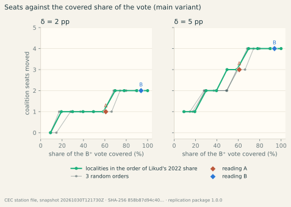
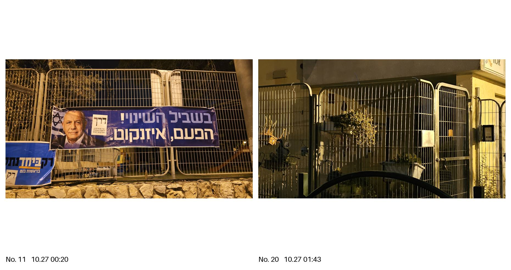

::: {lang=he}
# תקציר {#takzir}

בלילה שלפני הבחירות לכנסת ה־26 (27 באוקטובר 2026) הוסרו שלטי הרשימות המתנגדות לממשלה מגדרות מקומות קלפי בעיר אחת בישראל, ועל פי עדות הראייה של עורך הטקסט נמצאו במקומם שלטי הליכוד. אנו שואלים שאלה מותנית: אילו הוחלה אותה החלפה בכל מקום שבו נוכחות הליכוד אינה שולית — המגזר היהודי הלא־חרדי, {{ (cov.B.n_stations / data.current.regular_stations)|pct(0) }} % מן הקלפיות ו־{{ cov.B.share_regular|pct }} % מן הקולות הכשרים שניתנו בהן — כמה מתוך 120 המנדטים הייתה עשויה להזיז? אפקט היפותטי δ מופחת מן הליכוד ביישובים המכוסים של תוצאות האמת של ועדת הבחירות המרכזית, מוחזר לרשימות גוש השינוי באופן יחסי, וחלוקת המנדטים בשיטת בדר–עופר מחושבת מחדש במדויק, עם אחוז החסימה של 3.25 % והסכמי העודפים. בתרחיש המרכזי, כאשר δ שווה לנקודת אחוז אחת, עובר מנדט אחד: הליכוד מ־{{ f.seats["מחל"] }} ל־{{ g[("B", 1.0, "main")].seats["מחל"] }}, ישראל ביתנו מ־{{ f.seats["ל"] }} ל־{{ g[("B", 1.0, "main")].seats["ל"] }}. על פני δ מ־0.2 עד 5 נקודות עוברים בין אפס ל־{{ -g[("B", 5.0, "main")].d_blocs.coalition }} מנדטים, הראשון כאשר ⁦δ = {{ bp.B["1"]|d }}⁩; ההסתברות למנדט אחד לפחות היא {{ mc.B.p_ge["1"]|pct(0) }} % על פני טווח הערכים של δ בספרות המחקר ו־{{ mcp.minimal.B.p_ge["1"]|pct(0) }} % בהנחת התפלגות ספקנית. המספרים מותנים בהנחת היסוד, שאותה התוצאות שפורסמו אינן יכולות לאשר או להפריך; הם מציינים את סדר הגודל שעליו שואל המבחן המשפטי «עשוי היה להשפיע על תוצאות הבחירות» (סעיף 86 לחוק הבחירות לכנסת \[נוסח משולב\]). כל הקוד, הנתונים הרשמיים והטבלאות הדרושים לשחזורם מפורסמים.
:::

**About this text.** The text, the code and the computations were drafted by an AI coding assistant (Claude Code, Anthropic) under the direction of Raveh Neeman, who set the question, the premise, the coverage readings and the δ grid, reviewed every number and every sentence and takes responsibility for the text as its editor; it carries no author's ORCID. The editor is also the eyewitness of the documented case; the computation does not rest on his testimony (Statements). Every number is produced by the operations stated as formulas in Appendix E and implemented in the code it names, and checked as described in Appendix F.

**What this article says.** Under the premise that the replacement documented in Yokneam Illit was applied across the non-haredi Jewish sector with an effect of one percentage point, the seat allocation moves one seat — Likud {{ f.seats["מחל"] }}→{{ g[("B", 1.0, "main")].seats["מחל"] }}, Yisrael Beiteinu {{ f.seats["ל"] }}→{{ g[("B", 1.0, "main")].seats["ל"] }}. **What it does not say:** that the replacement happened anywhere but in that town; who removed or hung anything; that a seat was in fact moved; that «{{ -g[("B_haredi", 5.0, "main")].d_blocs.coalition }} seats» or «{{ mcp.premise.B.p_ge["1"]|pct(0) }} %» are its result — the first is the top corner of the grid (the whole Jewish sector, δ = 5), the second is one of three distributions of δ, and under a sceptical one the first seat has a probability of {{ mcp.minimal.B.p_ge["1"]|pct(0) }} %; and that the documented town alone could have moved a seat — at δ = 5 it would move {{ r.case_locality.moved_at["5"]|n }} votes, against the {{ r.case_locality.first_seat_votes.B|n }} the first seat needs.

# 1. Introduction

Between midnight and three in the morning of election day, 27 October 2026, the posters of the lists opposing the government were taken down from the fences of five polling sites in Yokneam Illit, a town of some twenty thousand voters in northern Israel, and, on the account of the eyewitness who is the editor of this text, Likud posters were hung in their place. He had hung the removed posters with his team that evening, photographed one fence before and after, and called the police at 02:18 (Appendix H). The removals themselves were not witnessed by the team or recorded, and the article makes no finding as to who removed the material or who hung Likud's. Whether the same happened elsewhere that night is not known from public data, and this article does not claim that it did.

The article asks a conditional question. *If* the replacement of one bloc's outdoor advertising by another's was applied wherever Likud's presence is not marginally low — operationally, the non-haredi Jewish sector, {{ (cov.B.n_stations / data.current.regular_stations)|pct(0) }} % of the regular polling stations and {{ cov.B.share_regular|pct }} % of the valid vote cast at them (reading B, § 2.2) — how many of the 120 Knesset seats could it have moved? The premise is stated once, here, as a condition; everything that follows is arithmetic under it: the seat-allocation law applied exactly to the Committee's final results, with a posited vote effect δ removed from the covered localities and returned to the lists whose posters were removed. Neither of the two inputs — where the replacement was applied and what it did to the exposed voters — is measured in public data. The coverage is therefore a reading fixed on the previous election's results, and the effect a central scenario with its range, so that a reader can see what each value requires.

The answer is this. At the central scenario, δ = 1 percentage point of a covered locality's valid votes, one seat moves: Likud {{ f.seats["מחל"] }}→{{ g[("B", 1.0, "main")].seats["מחל"] }} and Yisrael Beiteinu {{ f.seats["ל"] }}→{{ g[("B", 1.0, "main")].seats["ל"] }}, the coalition bloc {{ f.blocs.coalition }}→{{ g[("B", 1.0, "main")].blocs.coalition }}. The same seat moves at δ = 1 under every coverage reading of this article, from {{ cov.I.share_regular|pct(0) }} % to {{ cov.B_haredi.share_regular|pct(0) }} % of the vote. The first seat needs δ = {{ bp.B["1"]|d }} under reading B ({{ r.case_locality.first_seat_votes.B|n }} votes) and the second δ = {{ bp.B["2"]|d }}; at δ = 5, the largest effect the literature reports for a whole two-week campaign, {{ -g[("B", 5.0, "main")].d_blocs.coalition }} seats move. Integrating over three distributions of δ, the probability of at least one seat under reading B is {{ mc.B.p_ge["1"]|pct(0) }} % over the literature's range, {{ mcp.premise.B.p_ge["1"]|pct(0) }} % under the premise's own reading and {{ mcp.minimal.B.p_ge["1"]|pct(0) }} % under a sceptical one (§ 4.3).

Two reasons make the question worth answering exactly, now. Israeli law provides an election appeal whose test is not whether a defect changed the result but whether it «could have affected the results of the election» (§ 86 of the Knesset Elections Law [Consolidated Version], 5729–1969; *עשוי היה להשפיע על תוצאות הבחירות*). The appeal is to be filed within fourteen days of the publication of the results in the official gazette, which must follow the election within eight days under § 11 of the Basic Law [@knesset1958basic] and § 84(a) of the Elections Law — no later than 18 November 2026. A seat-scale calculation is the quantity that test names, and courts elsewhere have applied the same logic: the German Federal Constitutional Court ordered a partial repeat of the 2021 Bundestag election in Berlin on the test of *Mandatsrelevanz* [@bverfg2023berlin], and the Austrian Constitutional Court annulled the 2016 presidential run-off on the possibility of influence [@neuwirth2016austria]. And the same number is the stake of protecting campaign material around polling places by law (§ 6). The rest of the article says where every number comes from (§§ 2–4) and what the numbers do not mean (§ 5).

# 2. What is posited

## 2.1 The documented case

The case file (Appendix H) records what one team of three people saw. Between 21:00 on 26 October and 01:30 on 27 October the team hung posters of three change-bloc lists on the fences of six of the town's twelve polling sites. At the site on Ya'ar Odem Street 29 (יער אודם 29) the posters are photographed in place at 00:07–00:20 and the gate is photographed bare at 01:43–01:44. Between 02:00 and 03:00 the witness confirmed that the advertising of all lists not supporting the coalition had disappeared at five sites — four of the six where the team had hung posters and a fifth where it had not — and that Likud advertising hung on the freed places; this last rests on the statement alone. He reported the matter to the police by telephone at 02:18 and received a call back at 02:25 with, in his summary, no intention to act; he did not seek to file a complaint. The evidence is the verbatim statement of a named eyewitness with twenty-three time-stamped photographs and no independent source; the file grades it D on the project's scale and records the attribution to Likud teams as the witness's inference. The team's own placement of posters on school fences on the eve of the election is subject to § 10 of the Elections (Modes of Propaganda) Law, 5719–1959 [@knesset1959propaganda] and to the municipal by-law, and this article does not argue its lawfulness. Removing, destroying or defacing a notice carrying the election propaganda of a list is an offence under § 126(2) of the Knesset Elections Law whoever placed the notice and wherever it hung [@knesset1969elections]. Two documented events of other kinds that month — the Lod municipality's removal of the Joint List's posters while Likud's stayed up [@haaretz2026lod], and anonymous billboards styled as Ra'am's own campaign [@haaretz2026raam] — are not part of the premise.

Yokneam alone could not have moved a seat: its {{ r.case_locality.stations }} stations cast {{ r.case_locality.valid_curr|n }} valid votes in 2026, so the transfer of § 3.3 would move {{ r.case_locality.moved_at["1"]|n }} votes there at δ = 1 and {{ r.case_locality.moved_at["5"]|n }} at δ = 5, against the {{ r.case_locality.first_seat_votes.B|n }} votes the first seat needs under reading B. The town's own 2022→2026 swing (Likud {{ it.yokneam_share_prev|pct }} → {{ (it.rows|selectattr("locality_en", "equalto", "Yokneam Illit")|first).likud_share_curr|pct }} %) is uninformative about the premise, for the reason given in § 5.

## 2.2 The premise and where it applies

The premise speaks of a replacement wherever Likud's presence is not marginally low. Three readings of that phrase were fixed before the computation and operationalised on the 2022 results, the last election before the campaign, so that the covered set does not depend on the 2026 outcome:

* **Reading B**, the main reading — the non-haredi Jewish sector: localities classified Jewish by the Central Bureau of Statistics (CBS) and not haredi by voting history, plus the stations of the nine mixed cities (Jerusalem, Tel Aviv-Yafo, Haifa, Lod, Ramla, Acre, Nof HaGalil, Ma'alot-Tarshiha and Neve Shalom) whose combined share of the two Arab lists in 2026 is below 20 %: {{ cov.B.n_localities|n }} localities, {{ cov.B.n_stations|n }} of the {{ data.current.regular_stations|n }} regular stations ({{ (cov.B.n_stations / data.current.regular_stations)|pct }} %), {{ cov.B.share_regular|pct }} % of the valid votes cast at regular stations ({{ cov.B.share_all|pct }} % of all valid votes). This is the sector in which Likud campaigns and hangs posters, and so the bound of where a national campaign organisation could have applied the practice. The station rule inside the mixed cities is the one place where a 2026 quantity enters a definition: stations are renumbered between elections, so their 2022 shares cannot be matched; the rule sorts stations by sector, not by swing, and they carry {{ cov.B.by_sector.mixed|pct }} % of the regular vote.
* **Reading A**, the narrow alternative — localities where Likud was the first list in 2022 or trailed the first list by at most five points: {{ cov.A.n_localities }} localities, {{ (cov.A.n_stations / data.current.regular_stations)|pct }} % of the stations, {{ cov.A.share_regular|pct }} % of the regular valid vote. Yokneam Illit (Likud {{ it.yokneam_share_prev|pct }} % in 2022) is one of them.
* **Reading B⁺**, the widest — reading B plus the {{ cov.B_haredi.n_localities - cov.B.n_localities }} haredi localities: {{ cov.B_haredi.share_regular|pct }} %.


Reading A is cross-checked against an independent indicator, the prime minister's own campaign itinerary (Appendix G, with the press sources): the {{ it.n_ordinary_localities }} localities of his ordinary in-person campaign stops in 2026 had Likud shares of {{ it.min.share_prev|pct }}–{{ it.max.share_prev|pct }} % in 2022, median {{ it.median_share_prev|pct }} %, and Yokneam sits inside that range. The rule «Likud share 2022 ≥ {{ it.tau|pct }} %» (reading I), with the threshold set by the lowest of those stops, covers {{ cov.I.share_regular|pct }} % of the vote and is reported in Appendix A with the A rule at other gaps. Table 1 gives the composition of each set.


**Table 1. Coverage sets (2026 regular stations; sector labels from the CBS file and the 2021–2022 results): localities, stations, share of the regular stations and of the regular valid vote.**

| Set | Rule | Localities | Stations | Stations, % | Regular vote, % |
|------------------------------|------------------------------------|----------:|----------:|----------:|----------:|

| {{ cov[key].label }} | {{ cov[key].rule }} | {{ cov[key].n_localities|n }} | {{ cov[key].n_stations|n }} | {{ (cov[key].n_stations / data.current.regular_stations)|pct }} | {{ cov[key].share_regular|pct }} |


# 3. Method

## 3.1 Data

The 2026 results are the Central Elections Committee's final station-level results (*תוצאות האמת*, «the true results», published on 30 October 2026 [@inn2026final]), as downloaded on {{ data.current.snapshot_ts|dmy }} at {{ data.current.snapshot_ts[9:11] }}:{{ data.current.snapshot_ts[11:13] }} UTC [@cec2026results] (file name and SHA-256 checksum in Appendix D). The file holds {{ data.current.regular_stations|n }} regular polling stations in {{ data.current.localities|n }} localities with {{ data.current.valid_regular|n }} valid votes, plus {{ data.current.external_valid|n }} valid votes in externally cast («double») envelopes — soldiers, diplomats, patients, prisoners and other absentee voters — which belong to no locality. The national totals include the external envelopes; the coverage sets and the counterfactual act on regular stations only. The 2022 results are the final station-level file of the 25th Knesset [@cec2022results]. Localities are classified by the CBS localities file [@cbs2024localities] into Jewish, Arab, Bedouin and mixed; haredi localities are those where the two haredi lists took at least half of the valid votes in 2021; Druze localities, coded with the Arab ones by the CBS, come from a list in the package. Every output carries the data version — the files' time stamps and SHA-256 checksums (Appendix D).

## 3.2 Seat allocation

Israel elects its 120-member Knesset in a single nationwide district by closed lists. Lists with at least 3.25 % of the valid votes share the seats by the Bader–Ofer method (§§ 81–82 of the Knesset Elections Law): highest averages, with two lists that signed a surplus-vote agreement (*הסכם עודפים*) treated as one unit, their joint seats then divided by the same rule — the Jefferson–D'Hondt rule applied first to the pairs and then within each pair [@balinski2001fair; @pukelsheim2017proportional]. Our implementation (in the package; Appendix E names an independent single-file reimplementation) returns the official allocation of the 25th Knesset list for list on the final 2022 file — a test in the package (passed**not passed**). The {{ ["no", "one", "two", "three", "four", "five", "six", "seven", "eight"][r.agreements.pairs|length] }} agreements of 2026 — {{ a|name }}–{{ b|name }},  — are taken from two concordant press reports [@oren2026surplus; @knessettv2026surplus]; the Committee's own notice could not be reached and the pairs are marked unverified in the package. In the count used here {{ data.current.valid_all|n }} valid votes were cast, {{ f.threshold_votes|n }} were needed to pass the threshold, {{ f.eligible|length }} lists passed it and {{ f.wasted_votes|n }} votes ({{ f.wasted_share|pct }} %) went to lists that did not. One seat therefore corresponds to {{ (f.votes_per_seat_quota / (1 - f.wasted_share))|n }} valid votes ({{ (1/120)|pct(2) }} % of the valid vote). The allocation is a step function: the 120th seat went to the pair {{ f.last_awarded[0].split("+")|map("name")|join("–") }} with a quotient of {{ f.last_awarded[1]|n }}, and the best losing quotient, {{ f.runner_up[1]|n }} for {{ f.runner_up[0].split("+")|map("name")|join("–") }}, fell short of it by {{ f.margin_votes|n }} votes (Appendix E.2). A shift of a few thousand votes in the right place moves a seat; a shift of tens of thousands in the wrong place moves none — which is why a seat estimate has to be computed exactly rather than divided out of a national swing. Table 2 gives the factual allocation and, beside it, the allocation at the central scenario.

**Table 2. Allocation of the Committee's results of {{ data.current.snapshot_ts|dmy }}, and the allocation under the counterfactual at δ = 1, reading B (lists above the threshold and the largest below it).**

| List (ballot letters) | Bloc | Votes | Share, % | Seats | Seats at δ = 1, B |
|----------------------|---------|---------:|--------:|------:|------:|


| {{ p|en }} | coalitionchangeArabother | {{ f.votes[p]|n }} | {{ f.shares[p]|pct(2) }} | {{ f.seats[p] }} | **{{ cB.seats[p] }}**{{ cB.seats[p] }} |


| {{ below[0][0]|en }} | other | {{ below[0][1]|n }} | {{ f.shares[below[0][0]]|pct(2) }} | 0 | 0 |
| *Blocs: coalition / change / Arab* | | | | {{ f.blocs.coalition }} / {{ f.blocs.change }} / {{ f.blocs.arab }} | {{ cB.blocs.coalition }} / {{ cB.blocs.change }} / {{ cB.blocs.arab }} |

The *coalition bloc* is the five lists that backed the incumbent prime minister before the election ({{ p|name }}, ), the *change bloc* the four that ruled that out ({{ p|name }}, ) and the *Arab bloc* the two Arab lists; «coalition seats» are the seats of the first bloc. The labels only report results — the allocation itself knows nothing of blocs — and Appendix C shows that an alternative frame changes the labels, not the arithmetic.

## 3.3 The counterfactual transfer

Let δ be the effect of the replacement on the exposed voters: the average treatment effect on vote share at the level of a covered unit, in percentage points of the unit's valid votes moved from Likud to the change-bloc lists — the quantity the field experiments of § 3.4 report, not a persuasion rate; as a net transfer it changes the Likud–change margin by 2δ. The factual results are, under the premise, the results *with* the replacement; the counterfactual removes it. For every covered unit — a locality, or, in a mixed city, its covered stations together — Likud's votes are reduced by round(δ/100 × valid votes of the unit), capped at the Likud votes present, and the removed votes are returned to the four change-bloc lists in proportion to their actual votes in the unit, integer-exact by largest remainders. This rule — locality units, pro-rata return — is the *main variant*. Everything else is untouched, so the total of valid votes is conserved; the national totals are re-allocated with the same threshold and agreements. The cap binds only where Likud's local share is below δ and amounts to under {{ (g[("B", 5.0, "main")].capped / g[("B", 5.0, "main")].moved)|pct(1) }} % of the moved votes at δ = 5 under reading B. δ need not be uniform: because the rule removes a share of each unit's valid votes, a varying δ moves the same total as a uniform δ with the same vote-weighted mean; what changes is who receives the votes and where the cap binds, which the variants test.

Five variants probe the rule (§ 4.4). *Station units*: the transfer station by station rather than locality by locality. *Single recipient* (three variants): all removed votes return to one list — each of the three lists whose posters the witness hung (Yashar!, The Democrats, Beyachad) in turn — the extreme of an uneven return. *Likud mobilisation*: the removed votes vanish instead of moving, as if the replacement had brought Likud voters to the polls who would otherwise have stayed home; a demobilisation of change-bloc voters — votes not cast rather than moved — is a third direction, not modelled as a variant and entered in § 3.4 at half weight. The threshold channel — a list below the threshold carried over it by the advertising it lost — is deliberately not modelled: the recipients are lists already above the threshold, the set of qualifying lists is held at the factual one, and the code records any deviation (there is none in any cell). The largest list below the threshold, {{ below[0][0]|name }}, stood at {{ f.shares[below[0][0]]|pct(2) }} %; whether its material was removed anywhere is unknown.

## 3.4 The effect δ

δ is not estimated in this article: we found no study that measures the effect on votes of removing an opponent's outdoor advertising, let alone of replacing it with one's own. What is measured is nearby. The only randomised field experiments with signs we found, four in 376 US precincts, give a pooled effect of +1.7 percentage points (standard error 0.7) for the advertised candidate and no effect on turnout [@green2016lawn]. The closest study to the Israeli medium is a working paper on Barcelona, where the municipality assigns lamp-post banner and poster slots to parties by lottery: +0.61 to +0.96 points of vote share per standard deviation of a party's poster density around a census tract, negative effects of a distant party's posters. It also reports +5 points for a party in tracts whose residents saw posters of that party only — single-party exposure, the closest analogue of a street on which only one side is visible [@estebancasanelles2021exposure]. Canadian household signs are of the same order, +1.5 to +3.4 points with diminishing returns [@maurice2023signs]. For scale, the persuasive effect of campaign contact and advertising in general elections is close to zero, with a 95 % interval of roughly −0.5 to +1.7 points across 49 field experiments [@kalla2018minimal]. Television advertising shifts vote intention by about 0.7 points per exposure, not distinguishable from zero [@coppock2020small], and shares by 0.2–0.5 points per standard deviation of imbalance [@sides2022television; @spenkuch2018advertising]. Persuasive effects decay within one or two weeks [@gerber2011persuasive; @hill2013forget], so that exposure on the way to the polling station weighs more than exposure a week earlier. Posters of large parties act as signals of campaign strength [@dumitrescu2012posters]; a one-sided campaign in a repeat vote multiplied the lone campaigner's share several times [@jager2020persist].

The grid of Table 3 ties each scenario to one of these anchors. The premise is more specific than the literature: a replacement carried out in one night and visible through election day, and — in the editor's reading of it — a sudden and total imbalance of posters that signals dominance — the governing party can do this, and the other side can do nothing about it. Table 3a assembles δ for that scenario from measured parts; the parts are the editor's judgement, stated so that a reader can replace them one by one. The first is the exclusivity effect, +5 points for two weeks of single-party exposure, which is the standing level of a decaying stock of exposures; one night and one day deliver 14–41 % of that level at half-lives of 7 to 2 days, 0.7–2 points. The second is the dominance signal: a bandwagon among late deciders — information about who is ahead moves some of them towards the leader by a few points [@morton2015exitpolls; @rothschild2014polls; @barnfield2020bandwagon] — and a demobilisation of the other side, which the intimidation literature documents for threats and violence [@bratton2008votebuying; @collier2014votes] and which a poster imbalance can at most echo. A vote not cast changes the margin by half as much as a vote moved, so the demobilisation part enters the transfer sum at half weight. The third is a deduction for backlash, the outrage of the targeted side and underdog reactions [@claassen2016yardsign].

**Table 3. The δ grid and its anchors.**

| δ, pp | Anchor |
|------:|------------------------------------------------------------------|

| {{ d.delta|d }} | {{ d.anchor }} |


**Table 3a. δ under the premise, assembled from measured parts (percentage points of a covered locality's valid votes, net transfer from the change bloc to Likud).**

| Part | Measured analogue | Range, pp | Centre |
|----------------------------------|----------------------------------------------|-----------:|--------:|
| Exclusivity: one side's posters alone, one night and one day | +5 pp after two weeks of single-party exposure (working paper); 14–41 % of a decaying stock delivered in a day and a half at half-lives of 7 to 2 days | 0.7–2.0 | 1.2 |
| Bandwagon among late deciders (dominance signal) | a few points among those who receive a signal of who is ahead; the late-deciding minority | 0.1–0.6 | 0.3 |
| Demobilisation of the other side (dominance signal) | threats and violence depress the targeted side's turnout; a poster imbalance is a weak cue; 0–0.5 points of turnout, at half weight as transfer | 0–0.25 | 0.1 |
| Backlash | outrage of the targeted side; underdog reactions | −0.3 to 0 | −0.1 |
| Sum | | 0.5–2.9 | ≈ 1.5 |

Three distributions of δ are carried through the results (Table 3b): the literature's range, 0.4–5 points; the premise's own reading, whose 5th percentile is the low of Table 3a and whose upper tail is widened to admit the reading in which a display seen on the way to the polling station is not discounted for decay at all. The third is a sceptical distribution (labelled «minimal persuasion effects» in the tables) that takes the 95 % interval of persuasion effects in general elections as the range of δ, cut below at 0.15 because the question concerns a positive effect. Each is a log-normal fixed by its 5th and 95th percentiles; none is a posterior — each propagates the uncertainty about δ only, treats the coverage as fixed by the premise and attaches no sampling error to the vote counts, which are population data.

**Table 3b. The distributions of δ (log-normal, fixed by the 5th and 95th percentiles).**

| Distribution | 5th pct | Median | 95th pct | What it formalises |
|------------------------|---------:|---------:|---------:|------------------------------------------|

| {{ p.label }} | {{ p.low|d }} | {{ p.median|num(2) }} | {{ p.high|d }} | {{ p.formalises }} |


The central scenario of this article is δ = 1. The parts of Table 3a centre near 1.5 and the medians of the first two distributions are {{ r.mc_params.median|num(1) }} and {{ (r.priors|selectattr("key", "equalto", "premise")|first).median|num(1) }}; δ = 1 is a round value in the lower half of the premise's own range, the Barcelona presence effect rounded up, and the headline that follows from it is the conservative one. Under reading B the answer «one seat» holds for every δ from {{ bp.B["1"]|d }} to {{ bp.B["2"]|d }} points. A reader who holds that the replacement moved no seat should read the article as a statement of what that claim requires: δ below {{ bp.B["1"]|d }} points under reading B and below {{ bp.A["1"]|d }} under A in the main variant.

## 3.5 Reproducibility

Everything in this article is produced by one command of the replication package from the archived official files: the factual allocation, the coverage sets, the grid, the step curves, the integration over δ, every table, every figure and the text itself, whose numbers are filled from a machine-readable results file that carries the data version (Appendix D). Appendix E restates every operation as a formula and names a single-file reference implementation (link, line count, SHA-256), written separately from the package, that recomputes every number of this text from the published tables alone; Appendix F lists the checks. Every file the text names is linked to its copy in the public repository.

# 4. Results

## 4.1 The central scenario

At δ = 1 under reading B the counterfactual moves {{ cB.moved|n }} votes ({{ cB.share_moved_national|pct(2) }} % of the national valid vote) from Likud to the four change-bloc lists, and one seat moves: Likud {{ f.seats["מחל"] }}→{{ cB.seats["מחל"] }}, Yisrael Beiteinu {{ f.seats["ל"] }}→{{ cB.seats["ל"] }} (Table 2, last column). The mechanism is the step function of § 3.2: the Likud–Religious Zionism pair's last quotient falls below the Beyachad–Yisrael Beiteinu pair's next one, and inside that pair Yisrael Beiteinu's next quotient is the higher. The result does not depend on the reading: at δ = 1 the same seat moves under every coverage set of this article, from the itinerary rule ({{ cov.I.share_regular|pct(0) }} % of the vote) to the whole Jewish sector ({{ cov.B_haredi.share_regular|pct(0) }} %; Table 4 and Appendix A), and under the station-unit variant and the return of all votes to Beyachad. It does not hold in two single-recipient variants under reading A ({{ -g[("A", 1.0, "victim_דרך")].d_blocs.coalition }} seats in each, § 4.4) nor in the Likud-mobilisation variant ({{ -g[("B", 1.0, "turnout")].d_blocs.coalition }} seats under both readings).


## 4.2 Breakpoints and the grid

Under the main variant the first coalition seat moves to the change bloc at δ = {{ bp.B["1"]|d }} under reading B and δ = {{ bp.A["1"]|d }} under reading A; the second at {{ bp.B["2"]|d }} and {{ bp.A["2"]|d }}; the third at {{ bp.B["3"]|d }} and {{ bp.A["3"]|d }}; the fourth at {{ bp.B["4"]|d }} and {{ bp.A["4"]|d }} (Figure 2). At δ = 0.2 no seat moves under any reading. The steps are unequal because the allocation is a step function of eleven lists' quotients: under reading B the second seat needs {{ (bp.B["2"] - bp.B["1"])|num(2) }} points of δ more than the first, the third {{ (bp.B["3"] - bp.B["2"])|num(2) }} more than the second. Table 4 gives the grid; the seats leave Likud in every cell and, with the exceptions noted next, go to the change-bloc lists, and the Arab bloc is unaffected in the main variant. In {{ ["no", "one", "two", "three", "four", "five", "six"][ns.cells|length] }} cells Likud loses more seats than the coalition total — {{ ns.cells|join("; ") }} — because a seat the Likud–Religious Zionism pair loses goes to whichever pair holds the next-best quotient, which can be a coalition partner. The full grid with the votes moved and the per-list allocations is in Appendix B.

**Table 4. Coalition seats moved by the counterfactual, main variant; the central scenario in bold.**

| Set | δ = {{ d.delta|d }} |
|------|----:|

| {{ key.replace("_haredi", "⁺") }} ({{ cov[key].share_regular|pct(0) }} % of the vote) | **{{ -g[(key, d.delta, "main")].d_blocs.coalition }}**{{ -g[(key, d.delta, "main")].d_blocs.coalition }} |


## 4.3 Integrating over δ

**Table 5. Integrating over δ, main variant: {{ r.mc_params.n_draws|n }} draws under each distribution of Table 3b.**

| Distribution of δ | Set | P(≥ 1 seat), % | P(≥ 2), % | P(≥ 3), % | Mean seats | 90 % interval |
|------------------------------|------|-----------:|--------:|--------:|--------:|-----------:|



| {{ p.label }} | {{ key }} | {{ m.p_ge["1"]|pct }} | {{ m.p_ge["2"]|pct }} | {{ m.p_ge["3"]|pct }} | {{ m.mean_seats_lost|num(2) }} | [{{ m.q05_seats_lost|num(0) }}, {{ m.q95_seats_lost|num(0) }}] |



Under the literature's range and reading B, one seat ({{ mc.B.pmf_seats_lost["1"]|pct(0) }} % of the draws) and two seats ({{ mc.B.pmf_seats_lost["2"]|pct(0) }} %) share most of the mass and the outcome of no seat has {{ mc.B.pmf_seats_lost["0"]|pct(0) }} %; under reading A the modal outcome is one seat ({{ mc.A.pmf_seats_lost["1"]|pct(0) }} %), with {{ mc.A.pmf_seats_lost["0"]|pct(0) }} % for none. The premise's own reading gives nearly the same figures. Under the sceptical distribution the probability of at least one seat falls to {{ mcp.minimal.B.p_ge["1"]|pct(0) }} % under B and {{ mcp.minimal.A.p_ge["1"]|pct(0) }} % under A: the number most sensitive to the choice of distribution is the probability of the first seat under reading A, whose breakpoint, δ = {{ bp.A["1"]|d }}, sits where a sceptic's δ sits; under reading B the first seat needs δ = {{ bp.B["1"]|d }}, below every distribution's median. Adding the haredi localities (B⁺) changes little, because Likud's share there is small and the cap binds (Appendix A). The reference implementation integrates the same step function exactly and agrees with the draws within half a point (Appendix F).

## 4.4 Sensitivity to the transfer rule

**Table 6. Coalition seats moved by variant (reading B / reading A).**


| δ, pp | {{ short.get(v.key, v.label) }} |
|-----:|----------:|

| {{ d.delta|d }} | {{ -g[("B", d.delta, v.key)].d_blocs.coalition }} / {{ -g[("A", d.delta, v.key)].d_blocs.coalition }} |


Station units and locality units give the same seat counts in every cell: the mix of recipients within a town does not matter at the scale of a seat. Returning all the votes to a single list can give a seat where the pro-rata return gives none and none where it gives one, because a seat moves only when a recipient's next quotient overtakes the losing one; the single-recipient variants bracket the main variant rather than shifting it. The Likud-mobilisation variant moves fewer seats for the same δ: Likud's loss is the same, but the freed seats go to whichever pair has the next-best quotient, including coalition partners, so the coalition total falls by {{ -g[("B", 5.0, "turnout")].d_blocs.coalition }} under B and {{ -g[("A", 5.0, "turnout")].d_blocs.coalition }} under A at δ = 5. The main variant is therefore not the most favourable variant in every cell.

## 4.5 Seats against the covered share

Readings A and B are two points of a range the premise leaves open. Figure 5 applies the main variant to the top x % of the B⁺ vote, taking the localities in the order of Likud's 2022 share and, for comparison, in {{ sc.n_random }} random orders, at δ = {{ sc.deltas|map("d")|join(" and δ = ") }}. At every covered share the ordered and the random coverages differ by at most {{ ["no", "one", "two", "three", "four"][ms] }} seats: from the second seat on, what the coverage decides is the volume of covered votes, not the choice of localities, and a reader who prefers another coverage can read the seats off the share of the vote it covers (the rows are the package's `coverage_scaling` table).



# 5. What the numbers do not mean

**The premise is a condition, not a finding.** The documented replacement covers one town with {{ (r.case_locality.valid_curr / data.current.valid_regular)|pct(1) }} % of the regular vote; everything beyond it is conditional. The readings of § 2.2 were fixed in advance and cross-checked against the campaign itinerary, but another reader may prefer another set, which is why Appendix A reports other rules and the code accepts any set of localities. The standard a hostile reader will apply is the one formulated for the 2020 US claims — a purported anomaly is either not a fact or not anomalous [@eggers2021noevidence]. The lesson of Bolivia 2019, where a statistical claim about an election was reversed on the same public data by another choice of estimator and the dispute ran for years [@idrobo2022bolivia; @escobari2024late], is why the method, the readings, the grid and the variants are published together from the first day. No pattern in the returns is claimed here.

**The aggregate swing neither confirms nor refutes the premise.** A natural check is whether the 2022→2026 swing of the covered localities differs from that of the uncovered ones. It cannot settle the question, for an identification reason: under the premise the decision to clear a locality depends on its political composition, so the contrast between cleared and uncleared localities coincides with the gradient of the coalition's share, along which the swing varies without any clearing — regression to the mean, different mobilisation in strongholds and in mixed cities, the common drift of strongholds. A placebo comparison on the pair 2021→2022, where no replacement is posited, shows steps of the swing along that gradient of the same sign and size. If the clearing happened everywhere that mattered, its effect sits in Likud's national swing, and the only uncleared comparison groups — Arab, haredi and left-leaning localities — differ from the cleared ones in everything else; the within-town contrast is closed too, because stations are renumbered between elections. Only a record of which fences were cleared and replaced — a dose — or an experiment can adjudicate the premise. The discipline followed here is that of the Moscow observer experiment: an effect, an explicit statement of where it applies, and a reservation on generalisation [@enikolopov2013field].

**δ comes from other contexts.** The anchors are US lawn signs and Barcelona lamp-post posters, measured over weeks in contests with other ballot structures; the replacement itself has, to our knowledge, not been measured; in Yokneam it acted from the clearing through the hours in which voters passed the fences, against a background of television and online campaigning. The distributions formalise the range of the literature and the editor's reading of the premise, and nothing more.

**The data are the Committee's final results, not yet the gazetted ones.** The results of 30 October 2026 are the ones the Committee published as final [@inn2026final], and the published file had not changed when this article was built; the published file changed after the download used here, and the article re-runs in one command on any later file. The margin of the last seat was {{ f.margin_votes|n }} votes, so the factual allocation may still change in the gazetted results, and with it every cell of the grid. The surplus-vote agreements are taken from two concordant press reports. The threshold channel is not modelled; the Jewish part of the mixed cities is defined by a station-level rule; the transfer is deterministic and integer-exact.

# 6. Implications and prevention

**The appeal.** For the test of § 86, the article supplies the magnitude under an explicit premise: the defect is the removal and replacement of a list's propaganda at polling sites, an offence under § 126(2), documented at one site before and after; the magnitude is one seat at the central scenario and the first seat at δ = {{ bp.B["1"]|d }} under reading B. What the premise leaves open is the coverage, and a faction or list with a record of the localities affected can re-run the estimate on that set in one command (Appendix D). The standing to appeal lies with the members of the Central and district committees, the factions and members of the elected Knesset, the lists that took part and their candidates, and the Attorney General (§ 86(a)), within fourteen days of the gazette; the article claims nothing about the admissibility of any appeal.

**Prevention.** The law already names the act: § 126(2) and (3) of the Knesset Elections Law make removing, destroying or defacing a list's notice, and destroying or hiding its campaign material, offences whoever placed them; what the law lacks is a regime for the night before the vote. Section 129 silences meetings, processions, loudspeakers and broadcasts from 19:00 on the eve and says nothing of printed material; the outer fence of a polling building counts as part of the polling place from election day (§ 126(5)) while campaigns use it on the eve by general practice. Enforcement rests with the police, whose record of the one documented case is a telephone report at 02:18 without an event number, no complaint having been sought (Appendix H). Four measures follow, cheapest first; none presumes who did what in Yokneam, and none is a claim that the 2026 result was changed. (i) A freeze on hanging and removing printed material at polling buildings from 19:00 on the eve, aligned with § 129, with a logged hotline whose log is published after the election; Italy forbids new posting and rallies on the eve and the days of the vote and penalises the removal of posters [@italy1956propaganda]. (ii) Official panels at the entrance with equal, numbered slots drawn by lot by the district committee, the rest of the fence free but recorded — the Italian *spazi* [@italy1956propaganda]; Germany forbids any influencing of voters in, at and immediately before the polling building during the vote [@bwahlg_s32]. (iii) A record: a photographic census of every polling building's outer fence after 19:00 on the eve and before 07:00, keyed to the Committee's polling-site identifier (ריכוז) and published with the gazetted results; existing cameras on the fence and the panels only, never on voters or the entrance, with retention and access written into the statute. (iv) A measurement mandate: the census describes; the effect of one-sided exposure is estimable only by a pre-registered design with symmetric arms agreed between the lists, the subject of a separate measurement design and not computed here. Witnesses can contribute now what Appendix H has and what it lacks: time-stamped photographs handed in as original files and hashed on receipt, a complaint with an event number, and a request for footage inside the retention period.

# Data and code availability

The replication package [@neeman2026software] holds the code (the seat module with the code it imports and the input tables of lists, blocs and surplus agreements), the archived official files this build reads — the 2026 results, the 2022 file, the 2021 file from which the haredi labels are derived — with their checksums, the CBS localities file, the machine-readable results file, the CSV tables, the figures, this text's template and bibliography, the public summary of the case file with the twenty-three photographs published in full (Appendix H; {{ "case-01-yokneam-public.md"|art }}, {{ "case-01/"|art }}). It also holds the reference implementation of Appendix E ({{ "replication/reference.py"|art }}) with the tables it reads, and the command that regenerates all of them (Appendix D). Every file named in this text links to its copy in the public repository ({{ repo_url }}, ref `{{ repo_ref }}`). The investigator's protocol and the verbatim witness statement are retained by the editor and are not released. The package is prepared for deposit with a persistent identifier, to be added to this text when assigned.

# Statements

**Editor.** Raveh Neeman (independent researcher) is the editor of this article: he set the question, the premise, the coverage readings and the δ grid, reviewed every number and every sentence, and takes responsibility for the text as its editor; the text and the code were drafted by the AI tool named below under his direction. He is also the first-hand witness of the documented case in Yokneam Illit and hung the posters whose removal it records; he has been active for the opposition in that town's campaigns since 2019, was a member of the Yesh Atid party centre until the summer of 2026 and is not a party member now. Because the computation takes the premise as a condition, a reader who sets the witness statement aside still has §§ 3–4 intact; the statement is the reason the question is asked, not evidence for its answer.

**AI.** Claude Code (Anthropic) drafted this text, wrote and tested the code and ran the analysis and the literature search, under the editor's direction and subject to his review of every part. The transcripts of the sessions are retained by the editor; no number in the text comes from them — every number is produced by the code of Appendix E from the published files. References with a DOI were resolved and checked against Crossref ({{ "tools/verify_bib.py"|repo }}); every reference without a DOI was opened and checked against its source on 1 November 2026. The editor reviewed and takes responsibility for all of it.

**Independence.** This work has no client, no sponsor and no funding. Nobody outside the editor commissioned or paid for any part of it, and no other person saw the text before it was sent for review. The editor's contact with the lists whose posters he hung was limited to reporting the removal to their local representatives on the morning of 27 October; none of them has seen this text.

# Glossary

| English | Hebrew | Note |
|----------------------|----------------------|------------------------------|
| Bader–Ofer method | שיטת בדר–עופר | highest-averages allocation with surplus-vote agreements, §§ 81–82 |
| ballot letters | אותיות הרשימה | the one to three Hebrew letters that identify a list on the ballot (Table 2) |
| «the true results» | תוצאות האמת | the Committee's name for its final results |
| polling station | קלפי | the unit of the Committee's results file; *regular* (קלפי רגילה) when in a locality |
| polling site, building | מקום קלפי; ריכוז (the field of the Committee's file) | a building, usually a school, holding several stations |
| locality | יישוב | the Committee's and the CBS's unit, by the CBS locality code |
| external («double») envelopes | מעטפות חיצוניות / כפולות | absentee ballots counted centrally, no locality |
| surplus-vote agreement | הסכם עודפים | two lists pooled for the allocation of remaining seats |
| electoral threshold | אחוז החסימה | 3.25 % of the valid votes |
| haredi | חרדי | ultra-Orthodox; a locality is haredi here if UTJ and Shas took at least half of its valid votes in 2021 |
| coalition bloc, change bloc | גוש הקואליציה, גוש השינוי | the lists that backed the incumbent prime minister; the lists that ruled that out (§ 3.2) |
| readings A, B, B⁺ | — | the coverage sets of § 2.2 |
| δ | — | the posited effect of the replacement, in percentage points of a unit's valid votes moved from Likud |
| election appeal; «could have affected the results» | ערעור בחירות; עשוי היה להשפיע על תוצאות הבחירות | § 86 of the Knesset Elections Law; fourteen days from the gazette (רשומות) |
| outdoor advertising, posters, banners; replacement | שלטי חוצות, שלטים, כרזות; החלפה | the medium of the premise; removal of one side's material and placement of the other's |

# References

::: {#refs}
:::

# Appendix A. Other coverage readings

**Table A1. Coverage and coalition seats moved, main variant, for every reading of the package.**

| Set | Localities | Stations | Share of regular valid votes, % | δ = {{ d.delta|d }} |
|------------------------------|------:|------:|------:|----:|

| {{ cov[key].label }} | {{ cov[key].n_localities|n }} | {{ cov[key].n_stations|n }} | {{ cov[key].share_regular|pct }} | {{ -g[(key, d.delta, "main")].d_blocs.coalition }} |


Breakpoints (δ at which the n-th coalition seat moves, main variant): {{ cov[key].label }}: {{ bp[key][n]|num(2) if bp[key][n] is not none else "—" }} / ; . The rows are {{ "tables/coverage.csv"|art }} and {{ "tables/breakpoints.csv"|art }}.

# Appendix B. The grid in full and the seats by list

**Table B1. Seats under the counterfactual, main variant. Δ = counterfactual − factual.**

| Set | δ, pp | Votes moved | Likud seats (Δ) | Coalition (Δ) | Change bloc (Δ) | Arab bloc (Δ) |
|---|---:|---:|---:|---:|---:|---:|



| {{ key.replace("_haredi", "⁺") }} | {{ d.delta|d }} | {{ c.moved|n }} | {{ c.likud }} ({{ c.d_likud|signed }}) | {{ c.blocs.coalition }} ({{ c.d_blocs.coalition|signed }}) | {{ c.blocs.change }} ({{ c.d_blocs.change|signed }}) | {{ c.blocs.arab }} ({{ c.d_blocs.arab|signed }}) |




**Table B{{ loop.index + 1 }}. Seats of every qualifying list, factual and counterfactual (main variant), reading {{ key }}.**

| List | Factual | δ = {{ d.delta|d }} |
|------------------------------|------:|------:|

| {{ p|en }} | {{ f.seats[p] }} | {{ g[(key, d.delta, "main")].seats[p] }} |



Every cell of every variant is in {{ "tables/grid_all_variants.csv"|art }}; the main variant alone in {{ "tables/grid_main.csv"|art }}.

# Appendix C. An alternative bloc frame

The bloc labels of § 3.2 are one reading of the lists' alignments. The package also reports every cell under another frame — «opposition with Ra'am» ({{ p|name }}, ), the Netanyahu bloc, which is the coalition bloc of § 3.2, the Joint List apart, and the change bloc without Beyachad, whose placement is the one bloc assignment a reader may dispute — in the `frame_*` columns of {{ "tables/grid_main.csv"|art }}. The frame changes the labels, not the arithmetic: the seats that leave the Netanyahu bloc go to the change-bloc lists in every cell, so the Netanyahu bloc falls by the coalition's Δ of Table 4 and the opposition rises by the same amount, while Ra'am and the Joint List are unaffected in the main variant; at the central scenario the opposition with Ra'am counts {{ cB.frames.opposition_with_raam }} seats against {{ f.frames.opposition_with_raam }} factual, and the change bloc without Beyachad {{ cB.frames.change_without_beyachad }} against {{ f.frames.change_without_beyachad }}.

# Appendix D. Reproduction

From the root of the replication package [@neeman2026software], with the archived official files in place (uv is a Python package manager, docs.astral.sh/uv):

```
uv run ef seats allocate -k 25            # the official 2022 allocation
uv run ef seats allocate                  # the 2026 results, margin of the last seat
uv run ef seats build                     # results, tables, figures, this text
uv run ef seats build --snapshot F --pdf  # a pinned file F (the gazetted results), PDF
uv run python -X utf8 docs/article/replication/reference.py   # Appendix E
uv run pytest tests/                      # the checks of Appendices F, G and H
uv run python -X utf8 tools/verify_bib.py docs/article/references.bib     # refs
```

Data version of this build: results file {{ ("data/raw/knesset26/snapshots/" ~ data.current.file)|repo }} (SHA-256 `{{ data.current.sha256 }}`), 2022 file SHA-256 `{{ data.previous.sha256 }}`, CBS file SHA-256 `{{ data.cbs.sha256 }}`, code fingerprint `{{ r.code_sha256 }}`, package version {{ r.package_version }}, generated {{ r.generated_at }}. Results file: {{ "results.json"|art }}.

Codebook of the package tables ({{ "tables/"|art }}): the coverage keys are `A`, `B`, `B_haredi` (reading B⁺), `A3`, `A7`, `A10` (the A rule with gaps of 3, 7 and 10 points) and `I` (the itinerary cross-check); the variant keys are `main`, `station`, `victim_<letters>` (single recipient: the list with those ballot letters) and `turnout` (Likud mobilisation); the columns `seats_<letters>` and `v_<letters>` hold the seats and the votes of the list with those ballot letters (Table 2); the `frame_*` columns of the grid tables hold the alternative frame of Appendix C. The unit tables {{ "tables/units_A.csv"|art }}, {{ "tables/units_B.csv"|art }} and {{ "tables/units_B_haredi.csv"|art }} list the covered stations with their valid votes, Likud's votes and the change-bloc lists' votes; {{ "tables/curves_main.csv"|art }} is the step curve of § 4.2; {{ "tables/monte_carlo_priors.csv"|art }} the integration of § 4.3; {{ "tables/coverage_scaling.csv"|art }} the rows of § 4.5. The itinerary of Appendix G is {{ "itinerary_sources_k26.csv"|art }} (the hand-curated input: appearance, date, locality code of the Committee's file, venue, whether the stop enters the rule and why not, the sources and their URLs) and {{ "tables/itinerary_k26.csv"|art }} (the same rows joined with the locality's valid votes and Likud shares). The photographs of Appendix H are the original files under {{ "case-01/"|art }} (byte-exact, original names, full EXIF) with {{ "case-01/manifest.csv"|art }} (number as in the summary's table, file, night or context, EXIF capture time, GPS coordinates where recorded, device, pixel size, byte size, SHA-256, site, content); the contact sheets of § H.9 are renderings under {{ "case-01/preview/"|art }}.

# Appendix E. Every operation, as formula and as code

Notation: $V$ is the number of valid votes in the count (external envelopes included), $v_p$ the votes of list $p$ and $T = 0.0325\,V$ the threshold; a list qualifies if $v_p \ge T$. The units $u$ of the allocation are the qualifying lists, except that two qualifying lists with a surplus-vote agreement form one unit with $v_u = v_a + v_b$.

**E.1 Highest averages (§§ 81–82 of the Elections Law).** The 120 seats are awarded one at a time. Seat $t$ goes to the unit with the largest $v_u / (s_u + 1)$, where $s_u$ is the number of seats the unit holds before seat $t$; a tie goes to the unit with more votes. Equivalently, $s_u = |\{k \ge 1 : v_u / k \ge q^{\ast}\}|$, where $q^{\ast}$ is the 120th largest of all the quotients $v_u / k$. A pair's seats are then divided between its two lists by the same rule.

**E.2 Margin of the last seat.** Let $q_{\mathrm{last}}$ be the quotient that received the 120th seat and $q_{\mathrm{next}}$ the largest quotient that received none, belonging to a unit with $s_{\mathrm{next}}$ seats. The runner-up lacked $m = (q_{\mathrm{last}} - q_{\mathrm{next}}) \cdot (s_{\mathrm{next}} + 1)$ votes: with $m$ more votes its quotient would have equalled $q_{\mathrm{last}}$.

**E.3 The transfer (§ 3.3).** For covered unit $i$ with $n_i$ valid votes, $\ell_i$ votes for Likud and $c_{i1}, \dots, c_{i4}$ votes for the four change-bloc lists, the votes removed from Likud are $r_i = \min(\mathrm{round}(\delta\, n_i / 100),\ \ell_i)$, rounded half to even; $r_i = 0$ in a unit where $c_{i1} + \dots + c_{i4} = 0$ (nobody to return the votes to; the tables count these units). The $r_i$ votes are split $g_{ij} = \mathrm{LR}(r_i;\ c_{i1}, \dots, c_{i4})$ by largest remainders: each list receives $\lfloor r_i\, c_{ij} / \sum_j c_{ij} \rfloor$, and one more vote goes to each of the largest remainders until $\sum_j g_{ij} = r_i$. The counterfactual totals are $v'_{\mathrm{Likud}} = v_{\mathrm{Likud}} - \sum_i r_i$ and $v'_j = v_j + \sum_i g_{ij}$, every other list unchanged, so that $\sum_p v'_p = V$. In the station variant the units are polling stations instead of localities; in a single-recipient variant all $r_i$ go to one list; in the Likud-mobilisation variant (`turnout` in the tables) nothing is returned and $V' = V - \sum_i r_i$.

**E.4 Grid, step curve, breakpoints (§ 4.2).** A cell of the grid is $\Delta_{\mathrm{bloc}}(\delta) = \sum_{p \in \mathrm{bloc}} (s'_p - s_p)$, the seats of the bloc under the counterfactual totals minus its factual seats. The step curve evaluates the main variant at $\delta_i = i / 100$ for $i = 0, \dots, 1000$; the breakpoint $b_k$ is the smallest $\delta_i$ at which $-\Delta_{\mathrm{coalition}}(\delta_i) \ge k$. The votes the first seat needs (§ 1) are the votes moved at $b_1$.

**E.5 Integration over δ (§ 4.3).** $\delta$ follows a log-normal distribution with $\mu = \ln \sqrt{\ell h}$ and $\sigma = \ln(h / \ell) / (2 \cdot 1.645)$, so that its 5th and 95th percentiles are $\ell$ and $h$ points: $(\ell, h) = (0.4, 5.0)$ for the literature's range, $(0.5, 4.5)$ for the premise's own reading and $(0.15, 1.7)$ for minimal persuasion effects (Table 3b). The package draws {{ r.mc_params.n_draws|n }} values with seed {{ r.mc_params.seed }} and reads the curve at $\lfloor \delta / 0.01 \rfloor$, a draw beyond 10 points taking the curve's last value ({{ mc.B.share_above_curve_max|pct(1) }} % of the draws under the literature's range). The reference implementation integrates the same step function exactly: $P(k\ \text{seats}) = \sum_i \mathbf{1}[\mathrm{lost}_i = k] \cdot (\Phi(z_{i+1}) - \Phi(z_i))$ with $z_i = (\ln \delta_i - \mu) / \sigma$, $z_0 = -\infty$ and $z_{1001} = +\infty$; the two agree within the sampling error of the draws (Appendix F).

**E.6 Reference implementation.** The operations E.1–E.5 are implemented a second time, separately from the package, in one Python 3.12 file with no dependency beyond the standard library: {{ "replication/reference.py"|art }} ({{ reference_lines|n }} lines; SHA-256 `{{ reference_sha256 }}`, which binds this text to the file). It reads the national totals (Table 2), the 2022 totals and the covered stations of readings A, B and B⁺ — tables published with this text — and recomputes the factual allocation and its margin, every grid cell of the six variants, the step curves, the breakpoints and the exact integral over δ. It imports nothing from the package; the package's test suite runs it and asserts agreement on every number (Appendix F).

# Appendix F. Verification and validation

The computation is a piece of software, and this appendix says how it was checked. The checks are executable: the package's test suite ({{ "tests/test_seats.py"|repo }}, {{ "tests/test_reference_implementation.py"|repo }}, {{ "tests/test_itinerary.py"|repo }}, {{ "tests/test_case01_exhibits.py"|repo }}) runs them on the archived files and the published tables.

**F.1 Validation against official allocations.** On the archived final file of the 2022 election the package returns the official allocation of the 25th Knesset list for list, 32 / 24 / 14 / 12 / 11 / 7 / 6 / 5 / 5 / 4 (passed**failed** in this build), and the reference implementation returns the same from the published 2022 totals alone. On the pinned 2026 file the package returns the seat distribution the Committee's results site showed for that count, 27 / 21 / 12 / 11 / 8 / 8 / 7 / 7 / 7 / 6 / 6. Without the agreements one seat moves from the Arab lists to the coalition ({{ r.no_agreements.coalition }} / {{ r.no_agreements.change }} / {{ r.no_agreements.arab }}), the known effect of the 2026 agreements.

**F.2 Verification by redundancy.** The reference implementation of Appendix E was written separately from the package, imports nothing from it and reads only the published tables. The test asserts agreement on the factual allocation, the unit that won the 120th seat, the runner-up and the margin; every cell of the grid for readings A, B and B⁺ — six values of δ and six variants, 108 cells — list by list, with the votes moved, capped and returned and the number of units without recipients; the three step curves point by point (1,001 values each); the breakpoints; and the integral over δ under each of the three distributions of Table 3b, where the exact integral and the package's draws must agree within half a percentage point on every P(≥ k) and within 0.01 seat on the mean.

**F.3 Hand-computed examples.** Both implementations reproduce two examples small enough to check by hand. Allocation: 10 seats, votes A 60, B 25, C 15 — without an agreement A 7, B 2, C 1; with a B–C agreement the tenth seat goes to the pair (quotient 10 against A's 8.57): A 6, B 3, C 1, and the runner-up A lacked (10 − 60/7) · 7 = 10 votes. Transfer: a unit with 1,000 valid votes, 300 for Likud and 200 / 100 / 0 / 50 for the change lists, δ = 2: 20 votes leave Likud and return 11 / 6 / 0 / 3 by largest remainders. The tests also cover the cap, the unit without recipients and the Likud-mobilisation variant.

**F.4 Property checks.** The transfer conserves the total of valid votes in every variant but Likud mobilisation; at δ = 0 every variant returns the factual allocation; the largest-remainder split is integer-exact and proportional; station and locality units remove the same order of votes; every allocation sums to 120 seats; the estimate runs end to end on synthetic elections; the figures are byte-reproducible; the coverage sets reproduce the counts fixed before the computation; the results file carries no machine path. The itinerary table (Appendix G) is checked for its form and for its consequence: the threshold of reading I is the lowest 2022 share among the ordinary stops rounded down to a tenth of a point, so that the threshold printed is the threshold applied and every ordinary stop is inside the set it selects. The photographs of Appendix H are checked file by file against the manifest and the summary's list of hashes, with their EXIF present.

**F.5 What is not verified independently.** The reading of the Committee's file and the sector labels of the localities (the ingest and classification code, which the reference implementation does not repeat) are checked by the reproduction of the official allocations and by the coverage counts, not by a second implementation; the random orders of § 4.5 are produced by the package alone; the itinerary table is hand-curated from press reports, and the tests check the table, not the reports, which a reader can open from the links of Appendix G. These are the places where a reviewer should look first.


# Appendix G. The campaign itinerary behind reading I

Reading I (§ 2.2, Appendix A) takes its threshold from the prime minister's own campaign: the lowest 2022 Likud share among the localities of his ordinary in-person campaign stops. An appearance is listed when at least one dated press report or dated agency photograph places the prime minister there; the window runs from the Knesset's dissolution ({{ it.window[0]|dmy }}) to election night ({{ it.window[1]|dmy }}); the Hebrew and English press were searched on 30–31 October 2026 and every page linked below was opened again on 1 November 2026. Announced visits that were cancelled or postponed are not listed. The shares are Likud's share of the valid votes at the locality's regular stations in 2022 and in the 2026 results, computed by the package from the archived station files; the rows are {{ "itinerary_sources_k26.csv"|art }} and {{ "tables/itinerary_k26.csv"|art }}.

**Table G1. The {{ it.n_ordinary_localities }} localities of the ordinary campaign stops ({{ it.n_ordinary_appearances }} appearances; dates of 2026), Likud's share of their valid vote in 2022 and 2026, %, and the sources (links named after the publication).**

| № | Date | Locality | Venue and format | 2022 | 2026 | Sources |
|-----|-------|----------------------|------------------------------------|------:|------:|------------------------|

| {{ s.appearance }} | {{ s.date[8:10] }}.{{ s.date[5:7] }} | {{ s.locality_en|nbsp }} ({{ s.locality_he|nbsp }}) | {{ s.venue }} | {{ s.likud_share_prev|pct }} | {{ s.likud_share_curr|pct }} | {{ s.urls|srcs }} |


The lowest share is in {{ it.min.locality_en }} ({{ it.min.share_prev|pct(2) }} %), the highest in {{ it.max.locality_en }} ({{ it.max.share_prev|pct }} %), the median {{ it.median_share_prev|pct }} %; Yokneam Illit ({{ it.yokneam_share_prev|pct }} %) ranks {{ it.yokneam_rank }} of {{ it.n_ordinary_localities }}. The threshold is the lowest share rounded down to a tenth of a point, so that the rule as printed is the rule applied and every stop of Table G1 is inside the set: «Likud share 2022 ≥ {{ it.tau|pct }} %» selects {{ it.rule_at_tau.n_localities }} localities with {{ it.rule_at_tau.share_regular|pct }} % of the regular valid vote of 2026. The visited localities themselves hold {{ it.ordinary_share_regular|pct }} % of that vote.

**Table G2. Confirmed appearances outside the rule (dates of 2026), with Likud's 2022 share, the reason and the sources (venues in the package's table).**

| № | Date | Locality | Likud 2022, % | Why outside the rule | Sources |
|-----|-------|----------------------|--------:|------------------------------------------------|------------------------|

| {{ s.appearance }} | {{ s.date[8:10] }}.{{ s.date[5:7] }} | {{ s.locality_en|nbsp }} ({{ s.locality_he|nbsp }}) | {{ s.likud_share_prev|pct if s.likud_share_prev is not none else "—" }} | {{ s.exclusion_reason }} | {{ s.urls|srcs }} |


The exclusions are the editor's judgement, made when the itinerary was compiled, before the rule was evaluated and before any seat was computed: appearances in the prime minister's home city, a staged launch and a market visit in a city where Likud is not a leading list, two visits addressed to a sector in which Likud is not a leading list (Eli, Beit Shemesh), a state ceremony, the act of voting and the election-night speech. The meeting with the Druze community in Yarka is counted because Likud is a leading list there ({{ (it.rows|selectattr("locality_en", "equalto", "Yarka")|first).likud_share_prev|pct }} % in 2022); counting or excluding it leaves the threshold unchanged, since Lod sets the minimum. Had the two sectoral stops been counted, the threshold would be {{ it.tau_with_sectoral_stops|pct }} % and the rule would select {{ it.rule_at_tau_with_sectoral_stops.n_localities }} localities with {{ it.rule_at_tau_with_sectoral_stops.share_regular|pct }} % of the regular valid vote, close to reading B; a reader who prefers that reading finds its consequences in § 4.5. Dates: {{ s.appearance }} — {{ s.date_note }}; .


# Appendix H. Case file No. 1 — Yokneam Illit, the night of 26–27 October 2026: public summary and photographs

The public summary of the case file is reproduced here as it stands in the replication package ({{ "case-01-yokneam-public.md"|art }}). The twenty-three photographs are published in full in the package ({{ "case-01/"|art }}: the original files, byte-exact, with all their metadata, and {{ "case-01/manifest.csv"|art }}); § H.9 shows them on contact sheets. The conditional computation of §§ 3–4 takes no input from the case.

{{ case1_text }}

## H.9 The photographs (contact sheets; the files are in `case-01/`)

{width=100%}


![Contact sheet {{ sh.no }} — photographs Nos. {{ sh.photos[0].no }}–{{ sh.photos[-1].no }}, each in its displayed orientation with its number and EXIF capture time; sites and contents in § H.4, the files with their metadata and SHA-256 in `case-01/`.](case-01/preview/{{ sh.file }}){width=100%}


